# H3 Director — the guide

The same guide the **H3 Guide** node shows inside ComfyUI, all chapters in one file. Agents: see [SKILL.md](SKILL.md).

## Contents

- [1 · Start here](#1--start-here)
- [2 · Models and files](#2--models-and-files)
- [Workflow 1 · Text to video](#workflow-1--text-to-video)
- [Workflow 2 · Characters and voice](#workflow-2--characters-and-voice)
- [Workflow 3 · Music video](#workflow-3--music-video)
- [Workflow 4 · Shots from pictures](#workflow-4--shots-from-pictures)
- [Workflow 5 · Pictures](#workflow-5--pictures)
- [Workflow 6 · Storyboard](#workflow-6--storyboard)
- [Workflow 7 · Control video (pose, canny, depth)](#workflow-7--control-video-pose-canny-depth)
- [Workflow 8 · Inpaint: replace a figure](#workflow-8--inpaint-replace-a-figure)
- [Workflow 9 · Custom sampling (advanced)](#workflow-9--custom-sampling-advanced)
- [The Studio: shots and timeline](#the-studio-shots-and-timeline)
- [Content cards](#content-cards)
- [References or first frames](#references-or-first-frames)
- [Voices, dialogue and songs](#voices-dialogue-and-songs)
- [H3 Director: all settings](#h3-director-all-settings)
- [Writing with the AI](#writing-with-the-ai)
- [Pictures and the picture editor](#pictures-and-the-picture-editor)
- [Storyboard](#storyboard)
- [Control video (experimental)](#control-video-experimental)
- [Tips and problems](#tips-and-problems)

---

## 1 · Start here

The **H3 Director** makes videos of any length with MiniMax H3: you plan shots on a timeline, the Director cuts the video
into render parts of about ten seconds, renders them one after another and joins them into one video with sound. Picture
and sound continue across every join.

### How a workflow is built

Every workflow has the same chain, from left to right:

| Step | Nodes | What they do |
|---|---|---|
| 1 · Models | six ComfyUI loaders | load the two H3 models, the text encoder, the video, audio and preview VAE |
| 2 · Content | H3 Context Image / Video / Audio / Text | your pictures, videos, sounds and notes, each as a card with a name |
| 3 · Director | H3 Context Connector, H3 AI Loader, **H3 Director** | collect everything; plan the shots in the Studio |
| 4 · Render | H3 Render Sequence → Save Video | render all parts and save the video |

The **H3 Guide** (this node) does nothing when the workflow runs; you can delete it.

### Which workflow first?

| You want … | Open |
|---|---|
| a video from text alone | Workflow 1 · Text to video |
| your own character and voice | Workflow 2 · Characters and voice |
| a singer to your song | Workflow 3 · Music video |
| shots that start on your pictures | Workflow 4 · Shots from pictures |
| pictures instead of a video | Workflow 5 · Pictures |
| to plan with a storyboard sheet | Workflow 6 · Storyboard |
| movement from another video | Workflow 7 · Control video |
| to replace a person in footage | Workflow 8 · Inpaint |
| your own sampler nodes | Workflow 9 · Custom sampling (advanced) |

The workflows are in ComfyUI under **Templates** (or in the folder `example_workflows` of this node pack). Each one
opens with its chapter of this guide.

### Your first video

1. Open **Workflow 1 · Text to video**. Missing model files are offered for download (chapter 2).
2. Press **Generate** in the Director.
3. The video lands in `ComfyUI/output/H3/`.

Then change the shots, or go on with Workflow 2 for your own character.

### Words used in this guide

- **Shot**: one piece of the story on the timeline, with its own text (what happens, the camera).
- **Render part**: one H3 run of about 10 s. The Director plans them by itself; you see them under the timeline.
- **Card**: a Context node with one picture, video, sound or text. Its name is used as `@Name` in shots.
- **Mode**: *References* (Ref2VA, your pictures and voices as references) or *First / last frame* (FL2VA, shots start or
  end on your pictures). See chapter *References or first frames*.
- **Turbo**: renders with a turbo LoRA in 6–8 steps instead of 20, about three times faster.

---

## 2 · Models and files

Every workflow carries the download links of its models. When a file is missing, ComfyUI lists it when the workflow opens
and offers the download. The same list, with what was found on your machine, is in the Director under **Settings →
Models**. Your files may have other names or lie in a subfolder; then choose them in the loader.

### H3 (every workflow)

| What | File (click to download) | Folder | Size |
|---|---|---|---|
| H3 model: First / last frame | [minimax_h3_fl2va_pruned_int8_convrot.safetensors](https://huggingface.co/Comfy-Org/MiniMax-H3/resolve/main/diffusion_models/minimax_h3_fl2va_pruned_int8_convrot.safetensors) | `models/diffusion_models` | 19.5 GB |
| H3 model: References | [minimax_h3_ref2va_pruned_int8_convrot.safetensors](https://huggingface.co/Comfy-Org/MiniMax-H3/resolve/main/diffusion_models/minimax_h3_ref2va_pruned_int8_convrot.safetensors) | `models/diffusion_models` | 19.5 GB |
| H3 text encoder | [qwen3vl_32b_minimax_h3_nvfp4_awq.safetensors](https://huggingface.co/Comfy-Org/MiniMax-H3/resolve/main/text_encoders/qwen3vl_32b_minimax_h3_nvfp4_awq.safetensors) | `models/text_encoders` | 14.6 GB |
| H3 video VAE | [minimax_h3_video_vae_fp16.safetensors](https://huggingface.co/Comfy-Org/MiniMax-H3/resolve/main/vae/minimax_h3_video_vae_fp16.safetensors) | `models/vae` | 4.9 GB |
| H3 audio VAE | [minimax_h3_audio_vae_fp32.safetensors](https://huggingface.co/Comfy-Org/MiniMax-H3/resolve/main/vae/minimax_h3_audio_vae_fp32.safetensors) | `models/vae` | 0.6 GB |
| Preview VAE (taeh3) | [taeh3.safetensors](https://huggingface.co/Kijai/MiniMax-H3-TAE/resolve/main/vae_approx/taeh3.safetensors) | `models/vae_approx` | 0.02 GB |

Only the model a render part needs is loaded. A text-only project never loads the References model; a project with
character pictures never loads the First / last frame model.

### Turbo

| What | File (click to download) | Folder | Size |
|---|---|---|---|
| Turbo LoRA: First / last frame | [minimax_h3_fl2v_turbo_8step_v1.0_comfyui_bf16.safetensors](https://huggingface.co/Comfy-Org/MiniMax-H3/resolve/main/loras/minimax_h3_fl2v_turbo_8step_v1.0_comfyui_bf16.safetensors) | `models/loras` | 1.8 GB |
| Turbo LoRA: References | [minimax_h3_ref2v_turbo_4step_v0.1_comfyui_bf16.safetensors](https://huggingface.co/Comfy-Org/MiniMax-H3/resolve/main/loras/minimax_h3_ref2v_turbo_4step_v0.1_comfyui_bf16.safetensors) | `models/loras` | 1.8 GB |

They are chosen in **Settings → Turbo**. A known LoRA brings its own steps, sampler and scheduler (with 4 steps the
References LoRA leaves a white veil; 6 are clean). Other LoRAs work too; then the Director's own steps are used.

### Control videos and masks (Workflows 7 and 8)

| What | File (click to download) | Folder | Size |
|---|---|---|---|
| ControlNet (Fun Union 2.0) | [minimax_h3_fun_controlnet_union_2.0_pruned_int8_convrot.safetensors](https://huggingface.co/Comfy-Org/MiniMax-H3/resolve/main/model_patches/minimax_h3_fun_controlnet_union_2.0_pruned_int8_convrot.safetensors) | `models/model_patches` | 4.2 GB |
| SAM3 | [sam3.1_multiplex_fp16.safetensors](https://huggingface.co/Comfy-Org/sam3.1/resolve/main/checkpoints/sam3.1_multiplex_fp16.safetensors) | `models/checkpoints` | 1.8 GB |
| Pose: person detector | [rt_detr_v4-x-hgnet_fp16.safetensors](https://huggingface.co/Comfy-Org/SDPose/resolve/main/diffusion_models/rt_detr_v4-x-hgnet_fp16.safetensors) | `models/diffusion_models` | 0.1 GB |
| Pose: keypoints | [sdpose_wholebody_fp16.safetensors](https://huggingface.co/Comfy-Org/SDPose/resolve/main/checkpoints/sdpose_wholebody_fp16.safetensors) | `models/checkpoints` | 1.9 GB |
| Depth (MoGe) | [moge_2_vitl_normal_fp16.safetensors](https://huggingface.co/Comfy-Org/MoGe/resolve/main/geometry_estimation/moge_2_vitl_normal_fp16.safetensors) | `models/geometry_estimation` | 0.7 GB |
| Depth (Depth Anything 3) | `da3_base.safetensors` | `models/depthanything3` | 0.5 GB |

Depth Anything 3 is optional and needs the **ComfyUI-DepthAnythingV3** nodes, which download their model themselves.

### Pictures, storyboard and places (Workflows 5 and 6)

| What | File (click to download) | Folder | Size |
|---|---|---|---|
| Qwen Image 2.1 | [qwen_image_2.1_int8_convrot.safetensors](https://huggingface.co/Comfy-Org/Qwen-Image-2.1/resolve/main/diffusion_models/qwen_image_2.1_int8_convrot.safetensors) | `models/diffusion_models` | 7.3 GB |
| Qwen Image text encoder | [qwen3vl_8b_int8_convrot.safetensors](https://huggingface.co/Comfy-Org/Qwen-Image-2.1/resolve/main/text_encoders/qwen3vl_8b_int8_convrot.safetensors) | `models/text_encoders` | 9.4 GB |
| Qwen Image VAE | [qwen_image_2.1_vae_bf16.safetensors](https://huggingface.co/Comfy-Org/Qwen-Image-2.1/resolve/main/vae/qwen_image_2.1_vae_bf16.safetensors) | `models/vae` | 0.7 GB |
| Background removal | [birefnet.safetensors](https://huggingface.co/Comfy-Org/BiRefNet/resolve/main/background_removal/birefnet.safetensors) | `models/background_removal` | 0.4 GB |

### Sound

| What | File (click to download) | Folder | Size |
|---|---|---|---|
| Whisper | [small.pt](https://openaipublic.azureedge.net/main/whisper/models/9ecf779972d90ba49c06d968637d720dd632c55bbf19d441fb42bf17a411e794/small.pt) | `models/whisper` | 0.5 GB |

Whisper needs the `openai-whisper` package in ComfyUI's Python. Larger models (`medium.pt`, `large-v3.pt`) hear sung words
better.

### Example files

The pictures, voice, song and videos of the example workflows come with the node pack (`example_media`). They are copied
into ComfyUI's `input` folder on start, named `h3-example-…`; a file of the same name that is already there is kept.

### Little VRAM?

- **Render part: 5 s** in the Settings: smaller parts need less memory.
- The int8 video VAE [minimax_h3_video_vae_int8_convrot.safetensors](https://huggingface.co/Comfy-Org/MiniMax-H3/resolve/main/vae/minimax_h3_video_vae_int8_convrot.safetensors) instead of the fp16 one.
- A smaller **Resolution** (*Fast*: short side 480).

---

## Workflow 1 · Text to video

Your first video from text alone: three shots of a lighthouse at dusk, 15 seconds with sound and one spoken line. No
pictures or sound files are needed.

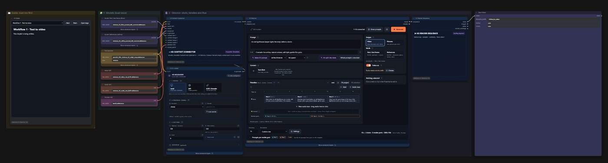

**The steps in short**

1. Load the models once (blue, yellow, red and purple nodes on the left).
2. Read the three shots in the **H3 Director**, change them if you like.
3. Press **Generate** in the Director (or ComfyUI's Run).
4. The video is saved by **Save Video** in `output/H3/`.

On a 16 GB card the 15 seconds take about 15–20 minutes with Turbo on.

### 1 · Models

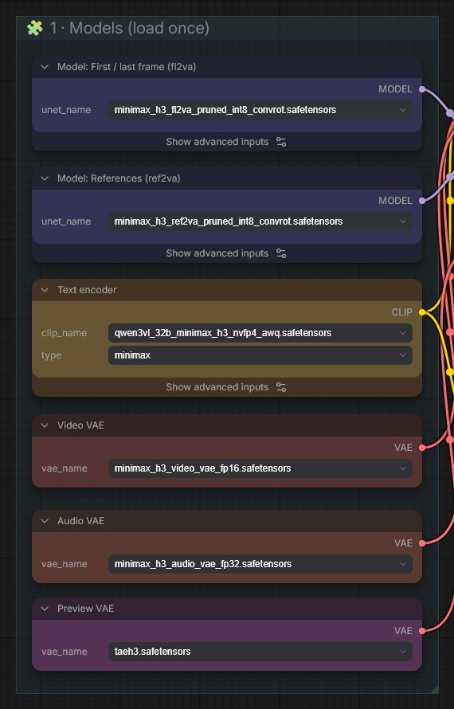

| Node | File | Folder |
|---|---|---|
| Model: First / last frame | `minimax_h3_fl2va_pruned_int8_convrot.safetensors` | `models/diffusion_models` |
| Model: References | `minimax_h3_ref2va_pruned_int8_convrot.safetensors` | `models/diffusion_models` |
| Text encoder | `qwen3vl_32b_minimax_h3_nvfp4_awq.safetensors` (type `minimax`) | `models/text_encoders` |
| Video VAE | `minimax_h3_video_vae_fp16.safetensors` | `models/vae` |
| Audio VAE | `minimax_h3_audio_vae_fp32.safetensors` | `models/vae` |
| Preview VAE | `taeh3.safetensors` | `models/vae_approx` |

A text-only project uses the **First / last frame** model; the References model is only loaded when a project uses
character pictures or voices. Missing files are offered for download when you open the workflow.

### 2 · H3 Context Connector and H3 AI Loader

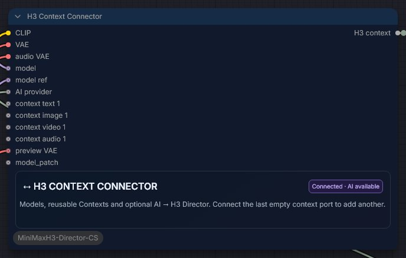

The **Connector** passes the models and the content on to the Director. This workflow has no content cards; text alone
works. The **preview VAE** shows each render part while it is made.

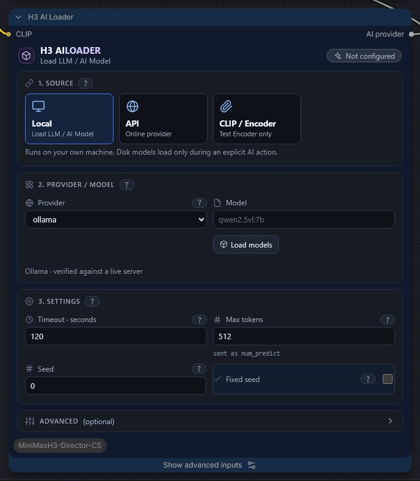

The **AI Loader** is optional. With an AI model (for example Qwen through Ollama) the Director can write shots from your
prompt (**AI: split into shots**) or improve a shot's text (**AI: improve text**). Without it, write the shots yourself.

### 3 · H3 Director

- **Prompt**: what the video is about. **Look**: the style every part shares.
- **Mode**: *Automatic → First / last frame* — with text only the Director picks FL2VA by itself.
- **Turbo on**: renders with the official turbo LoRA in 8 steps instead of 20.
- **Timeline**: three shots of five seconds. **Render parts** below shows that the Director renders the 15 seconds in two
  parts that continue into each other; you see only one video.

#### A shot

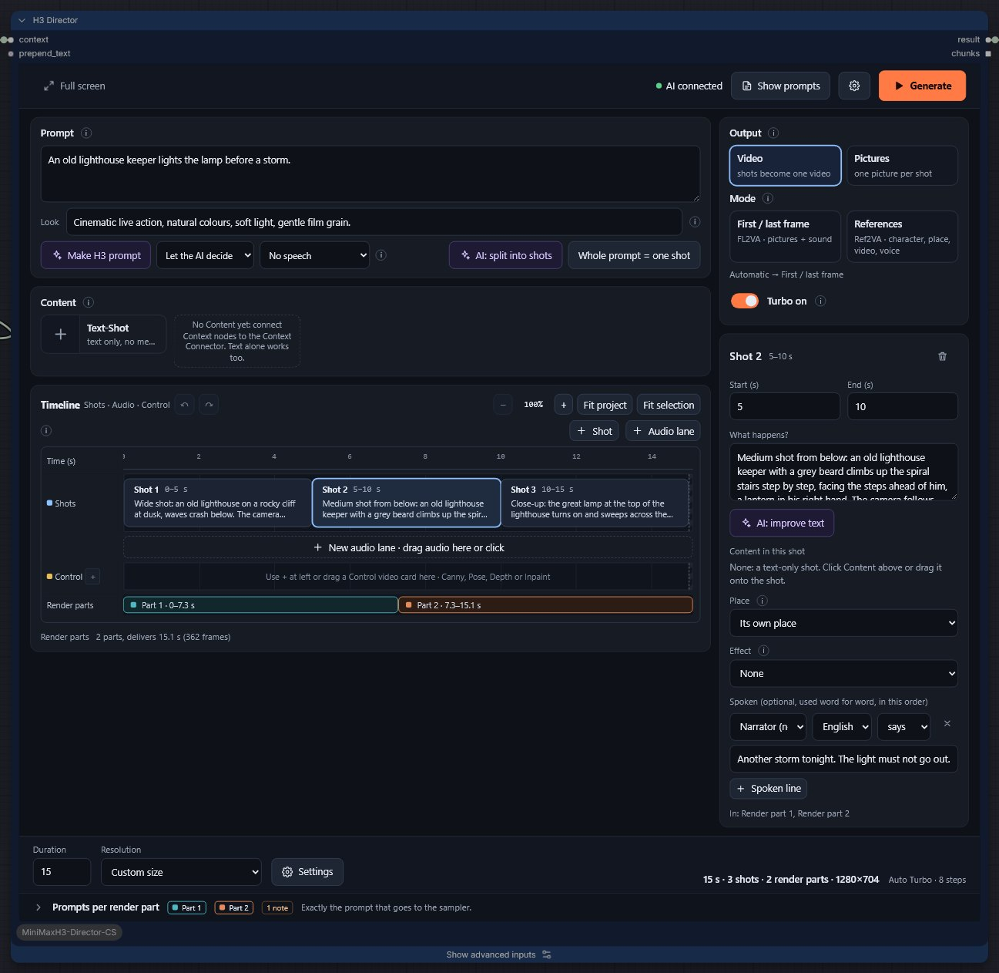

Click a shot to edit it on the right.

- **What happens?** Describe the picture, the action and the camera in one or two sentences: *Medium shot from below: an
  old lighthouse keeper … climbs up the spiral stairs step by step, facing the steps ahead of him … The camera follows him
  upward.* Say clearly in which direction a figure moves; "climbs the stairs" alone can come out as walking backwards.
- **Spoken**: the line is said word for word. *Narrator* speaks without a picture of the speaker.
- **In:** at the bottom shows in which render parts the shot lies.

### 4 · H3 Render Sequence and Save Video

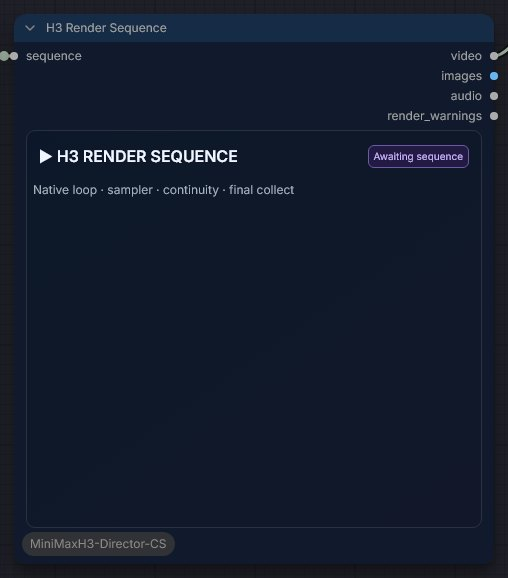

Renders the parts one after another and puts them together into one video with sound.

The finished video: `ComfyUI/output/H3/text_to_video_00001_.mp4`.

### Tips

- One camera sentence per shot keeps H3 from choosing its own camera.
- A new action needs about two seconds after a shot starts; very short shots (under 3 s) often show only the beginning.
- Longer videos: set **Duration** at the bottom of the Director and add shots; the Director plans the render parts.

---

## Workflow 2 · Characters and voice

A figure from your own picture walks through a town and speaks one line with a voice from your own sound file. This workflow
shows every node the H3 Director uses for that, from left to right.

**What you need:** a picture of your character (any size, the figure clearly visible) and a short sound file of the voice
(3–10 seconds of clear speech, no music).
The example opens with `h3-example-hero.jpg` and `h3-example-voice.wav`; choose your own files in the cards.

**The steps in short**

1. Load the models once (left column).
2. Put your picture into the **Image** card and your voice into the **Audio** card.
3. Check the two shots in the **H3 Director** and press **Generate**.
4. The video is saved by **Save Video** in `output/H3/`.

### The guide

This node is the guide you are reading. It does nothing when the workflow runs. Choose a chapter in the list, step with
**Back** and **Next**, or open it in a large window with **Open large**. Click a picture to see it full size.

### 1 · Models

Six ComfyUI loaders, each loads one file. They are the same in every workflow; the colours tell them apart (blue: the two
H3 models, yellow: the text encoder, red: the VAEs, purple: the preview VAE).

| Node | File | Folder |
|---|---|---|
| Model: First / last frame | `minimax_h3_fl2va_pruned_int8_convrot.safetensors` | `models/diffusion_models` |
| Model: References | `minimax_h3_ref2va_pruned_int8_convrot.safetensors` | `models/diffusion_models` |
| Text encoder | `qwen3vl_32b_minimax_h3_nvfp4_awq.safetensors` (type `minimax`) | `models/text_encoders` |
| Video VAE | `minimax_h3_video_vae_fp16.safetensors` | `models/vae` |
| Audio VAE | `minimax_h3_audio_vae_fp32.safetensors` | `models/vae` |
| Preview VAE | `taeh3.safetensors` (small, for the live preview) | `models/vae_approx` |

If a file is missing, ComfyUI offers to download it: the workflow carries the links. Your files can have other names or
lie in a subfolder; then pick them in the loader. Only the model a render part needs is loaded: a project in References
mode never loads the First / last frame model.

> Little VRAM? Use 5 s render parts (Settings) and the int8 video VAE `minimax_h3_video_vae_int8_convrot.safetensors`.

### 2 · Content: the Image card

The **H3 Context Image** card holds one picture and says what it is for.

- **Name** (top left): how you call the figure in the Studio. With the name *Hero* you write `@Hero` in a shot.
- **Picture**: choose a file from the list or press **Upload**. The pencil opens the picture editor (masks, poses, a
  character sheet), the gear the card's settings.
- **What is in it**: what the picture shows. Here *Character*.
- **Use as**: *Reference* keeps this figure recognizable wherever a shot uses it. *First frame* / *Last frame* make the
  picture the first or last frame of a shot instead (chapter *References or first frames*).
- **Keep in the video**: how strictly H3 keeps identity, outfit and pose of the picture. *Background: Ignore* lets the
  shot put the figure into its own place.
- **Belongs to**: leave *Independent* for a figure of its own. A second picture of the same figure (a side view, the back)
  belongs to the first one, otherwise H3 treats them as two people and switches between them.
- **Description**: one sentence of what the picture shows. H3 reads it together with the picture.

### 2 · Content: the Audio card

The **H3 Context Audio** card holds one sound file. Play it with ▶; the marked range is the part that is used.

- **What is in it**: *Voice*.
- **Use as**: *Voice* gives the figure the sound of this voice. (*Lock* keeps a song exactly as it is, see Workflow 3.)
- **Whose voice**: the figure that speaks with it, here *Hero*.
- **Listen here**: volume and fades only for listening in the browser; they do not change the video.
- **Lyrics**: only for a song or a speech whose words must be said exactly.

### 3 · H3 Context Connector

The Connector collects everything the Director needs: the models, the text encoder, the VAEs and the content cards.
Connect a new card to the last empty *context* input; a new empty input appears. The **preview VAE** shows every render
part while it is being made; without it the render works the same, only without the live picture.

### 3 · H3 AI Loader (optional)

The AI Loader lets an AI write for you: shot texts, the prompts of the render parts, descriptions of your pictures
(**Analyze** on a card). Nothing needs it — every workflow runs without AI.

- **Source**: *Local* (a model on your own machine, for example with Ollama), *API* (an online provider) or *CLIP /
  Encoder* (only reads, does not write).
- **Provider / Model**: for Ollama choose the model with **Load models**, e.g. a Qwen vision model.
- It is connected to the Connector and to every card; the Director shows **AI connected** at the top when it is ready.

### 3 · H3 Director: the Studio

The Director is where you plan the video. Everything happens inside the node.

- **Prompt**: what the whole video is about, in one or two sentences.
- **Look**: the style that every render part shares.
- **Output**: *Video*, or *Pictures* (one picture per shot, Workflow 5).
- **Mode**: *References* (Ref2VA) uses your character pictures and voices. *First / last frame* (FL2VA) starts shots on
  pictures. With the Image card set to *Reference* the Director chooses References by itself.
- **Turbo on**: renders with a few-step turbo LoRA: about three times faster. The LoRA is set in Settings.
- **Content**: the cards from the Connector. Drag a card onto a shot to use it there.
- **Timeline**: the shots, audio lanes and control clips over time. **Render parts** below shows how the Director cuts the
  video into parts of up to about 10 s that continue into each other.
- **Duration** and **Resolution** at the bottom; **Generate** at the top right starts the render.

#### A shot

Click a shot to edit it on the right:

- **Start / End** in seconds.
- **What happens?**: the action of the shot. `@Hero` names the figure from the Image card. Write how the camera moves,
  for example *The camera tracks beside her.*
- **Content in this shot**: the cards used in this shot.
- **Spoken**: a line that is said word for word, with the speaker, language and way of speaking.
- **Effect**: an official H3 camera effect such as *Bullet time* (only shown when the effect files are installed).

#### Settings (gear)

**Settings** holds everything a first video does not need: render part length, size, seed, steps, sampler, the turbo LoRA,
resume after a crash, sound and transitions, and the extra models. A known turbo LoRA brings its own steps and sampler
(here 6 steps for the References LoRA).

#### Prompts per render part

**Prompts per render part** (bottom of the Director) shows exactly the prompt that goes to H3 for every part, with the
notes of the planner above it. You can let the AI rewrite a part or edit it yourself.

### 4 · H3 Render Sequence

Renders the parts one after another, carries picture and sound across each seam, and puts them together into one video.
Outputs: *video*, *images* (in Pictures mode), *audio* and *render_warnings*. After a crash, finished parts are kept and
only the missing ones are rendered again.

### 5 · Save Video

ComfyUI's own Save Video. The file lands in `ComfyUI/output/H3/characters_and_voice_00001_.mp4`.

### Tips for this workflow

- Describe the camera in every shot. Without it H3 chooses its own camera and may cut away.
- One picture per figure, or set **Belongs to** for more pictures of the same figure.
- The voice sample should be clean speech. Music or noise in it changes the voice.

---

## Workflow 3 · Music video

A singer from your picture sings your song. The song stays exactly as it is (it is *locked*); H3 makes the picture and
the lip movement to it. The example has three shots of ten seconds.

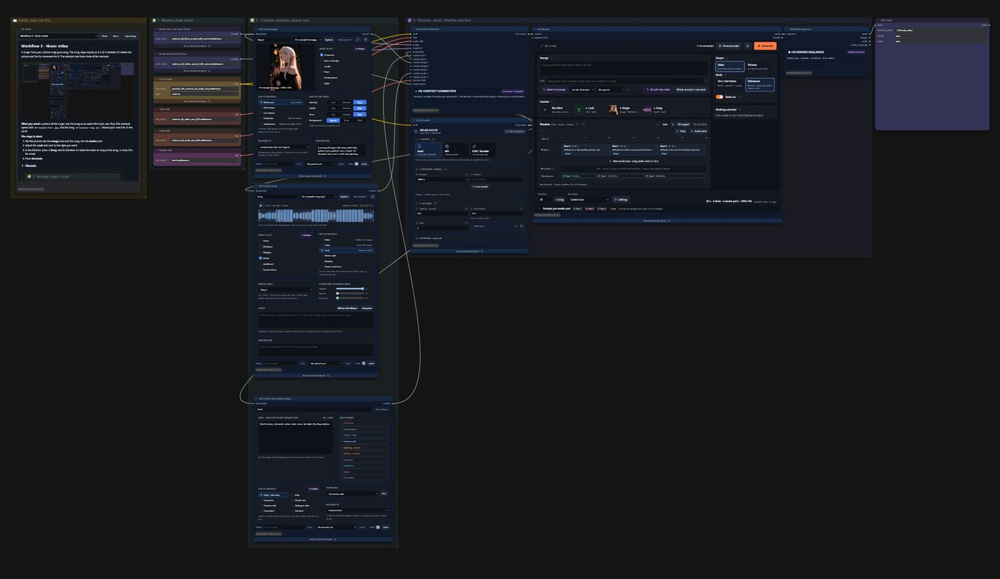

**What you need:** a picture of the singer and the song as an audio file (mp3, wav, flac).
The example opens with `h3-example-hero.jpg` and the song `h3-example-song.mp3`; choose your own files in the cards.

**The steps in short**

1. Put the picture into the **Image** card and the song into the **Audio** card.
2. Adjust the **Look** text card to the style you want.
3. In the Director press **= Song** next to *Duration* to make the video as long as the song, or keep 30 s for a test.
4. Press **Generate**.

### 1 · Models

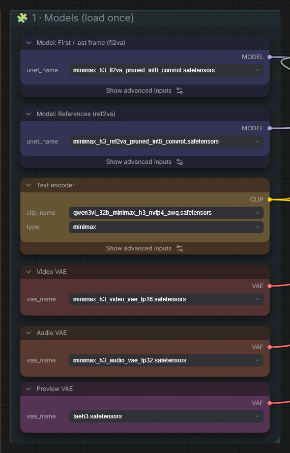

The same six loaders as in every workflow (see Workflow 1). A song with a singer uses the **References** model.

### 2 · Content

#### The singer: Image card

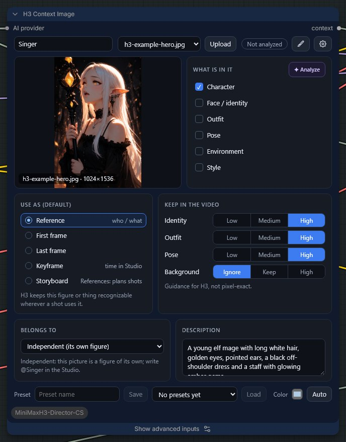

*Use as: Reference*. Describe the singer in **Description** (face, hair, outfit). For several views of the same singer
(side, back) add more Image cards and set **Belongs to** to the first one.

#### The song: Audio card

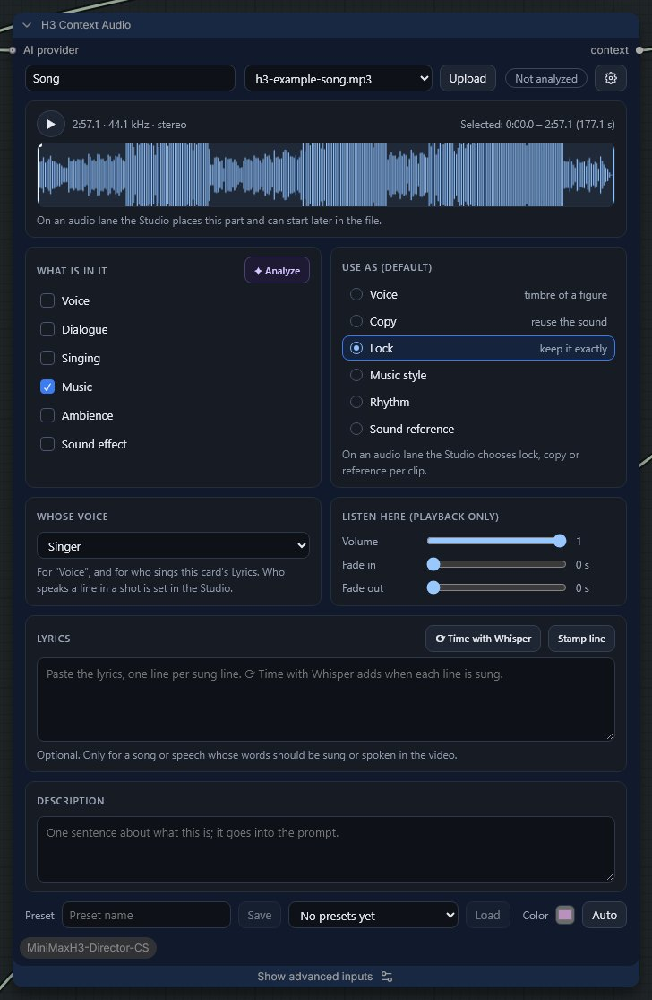

- **What is in it**: *Music*. **Use as: Lock** — the song is kept exactly, in every render part, without getting dull.
- **Whose voice**: the singer. The Director then knows whose lips move.
- **Lyrics** (optional): paste the lyrics, one sung line per row. **Time with Whisper** finds when each line is sung;
  the Director then writes each line into the part where it is heard.
- The range above the waveform is the part of the file that is used.

#### The style: Text card

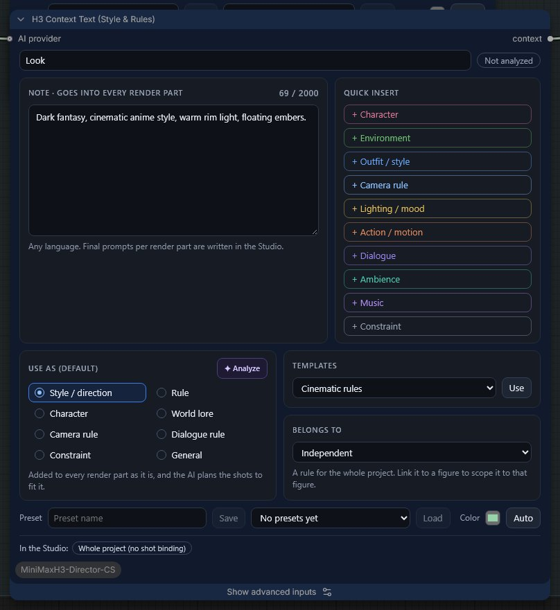

A **Text** card with *Use as: Style / direction* is added to every render part: colours, light, kind of film. The
**Quick insert** buttons on the right add common lines.

### 3 · H3 Director

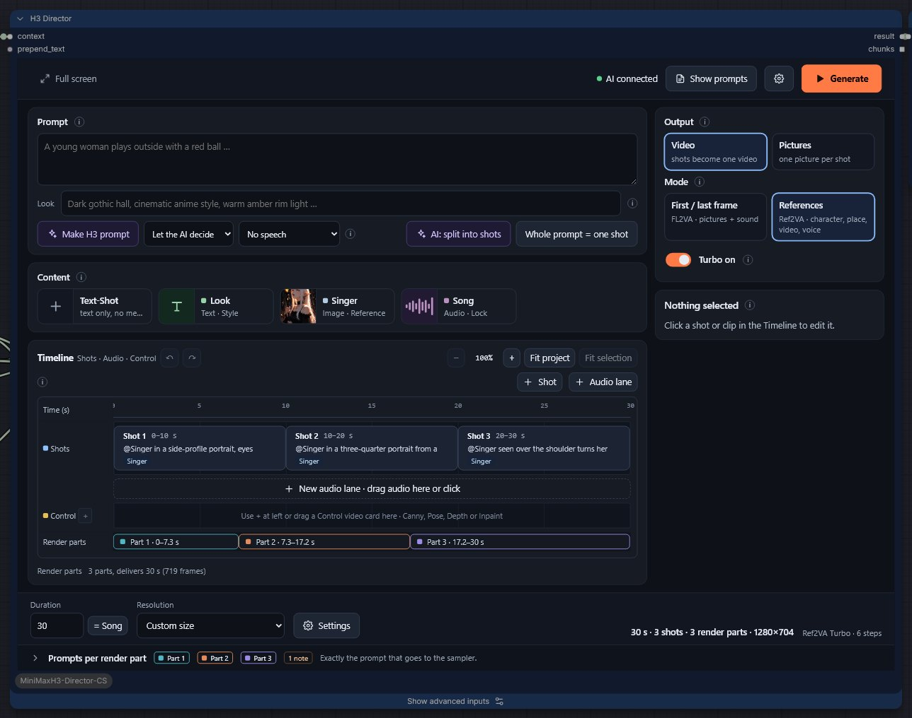

- **Mode: References** — the singer's picture and the song are references.
- **Content** shows the Look, the Singer and the Song.
- **Duration**: **= Song** sets the length of the song.

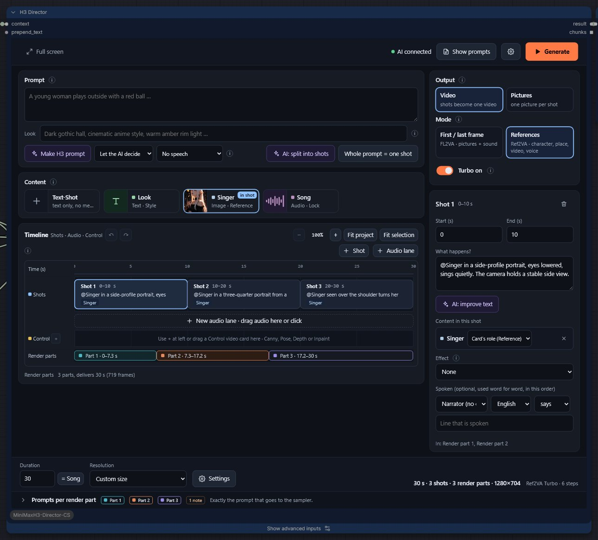

Every shot names the singer with `@Singer` and says how the camera moves. A change of view (profile, three-quarter,
over the shoulder) is a new shot; the Director keeps the song running across the cut.

#### What goes to H3

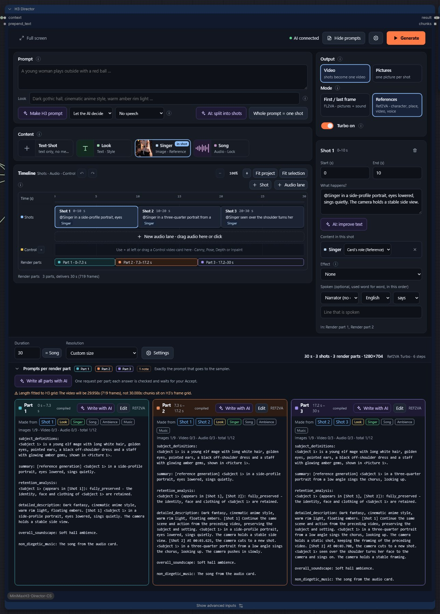

**Prompts per render part** shows for each part the sung lines it contains and the planner's notes.

### 4 · Render and save

The same as in Workflow 1: **H3 Render Sequence** → **Save Video** in `output/H3/`.

### Tips

- A whole song (3 minutes) takes several hours at 1280×704; try 30 s first.
- If the picture shows the singer from behind, she cannot sing visibly there — plan the shots so the face is seen when
  the important lines come.
- Words in a shot text such as "remembering her lost master" can make H3 show that person. Describe only what should be
  seen.

---

## Workflow 4 · Shots from pictures

Every shot starts exactly on one of your pictures and comes to life from there. This is **First / last frame** mode
(FL2VA): the picture is the first frame of the shot, not a reference.

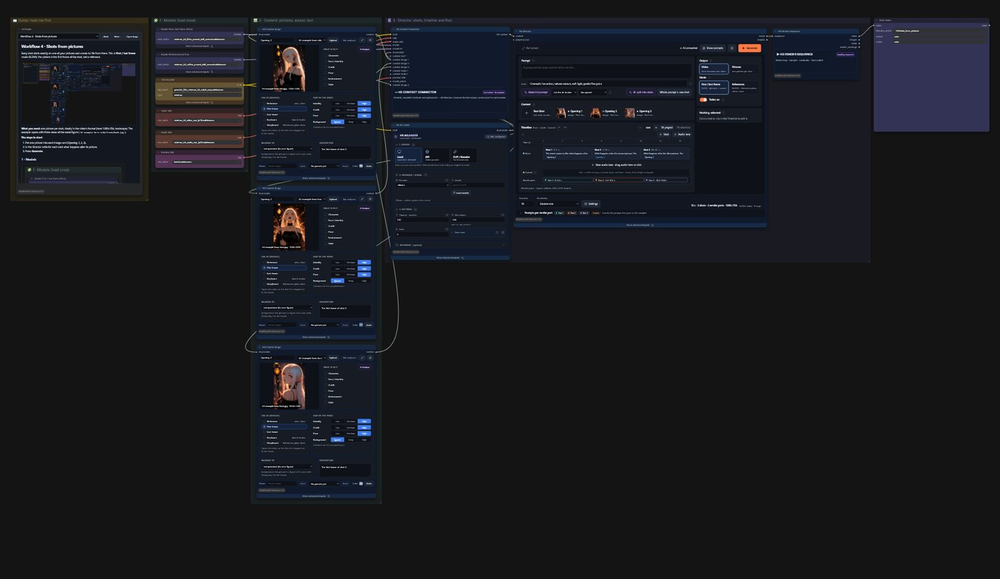

**What you need:** one picture per shot, ideally in the video's format (here 1280×704, landscape).
The example opens with three views of the same figure (`h3-example-hero-side/front/back.jpg`).

**The steps in short**

1. Put one picture into each Image card (*Opening 1, 2, 3*).
2. In the Director write for each shot what happens *after* its picture.
3. Press **Generate**.

### 1 · Models

The same six loaders as in every workflow. This mode uses the **First / last frame** model.

### 2 · Content: the pictures

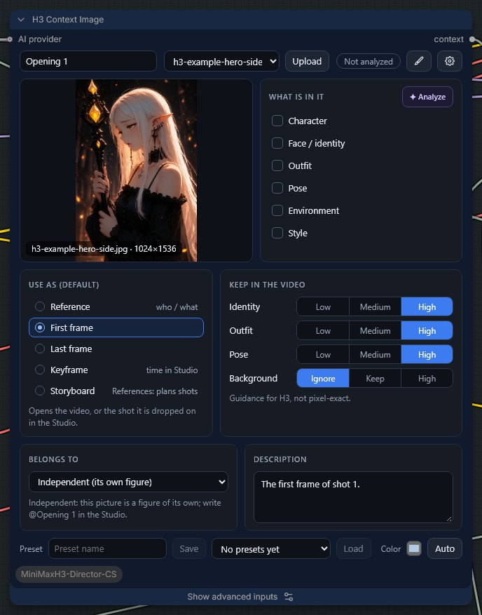

Each card is set to **Use as: First frame**. A picture that does not fit the video's format is fitted by **Fit
pictures** in the Settings (*Crop* by default).

### 3 · H3 Director

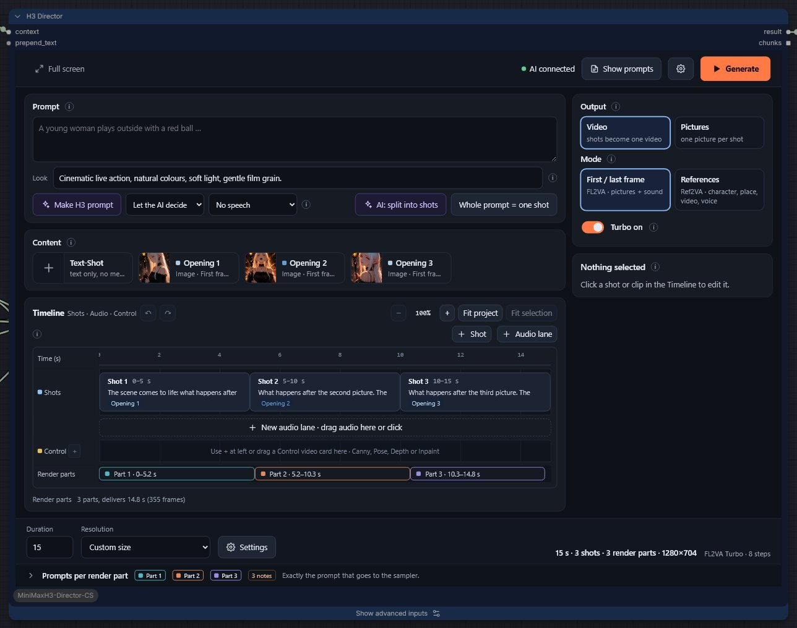

**Mode: First / last frame**. Each shot has its own picture.

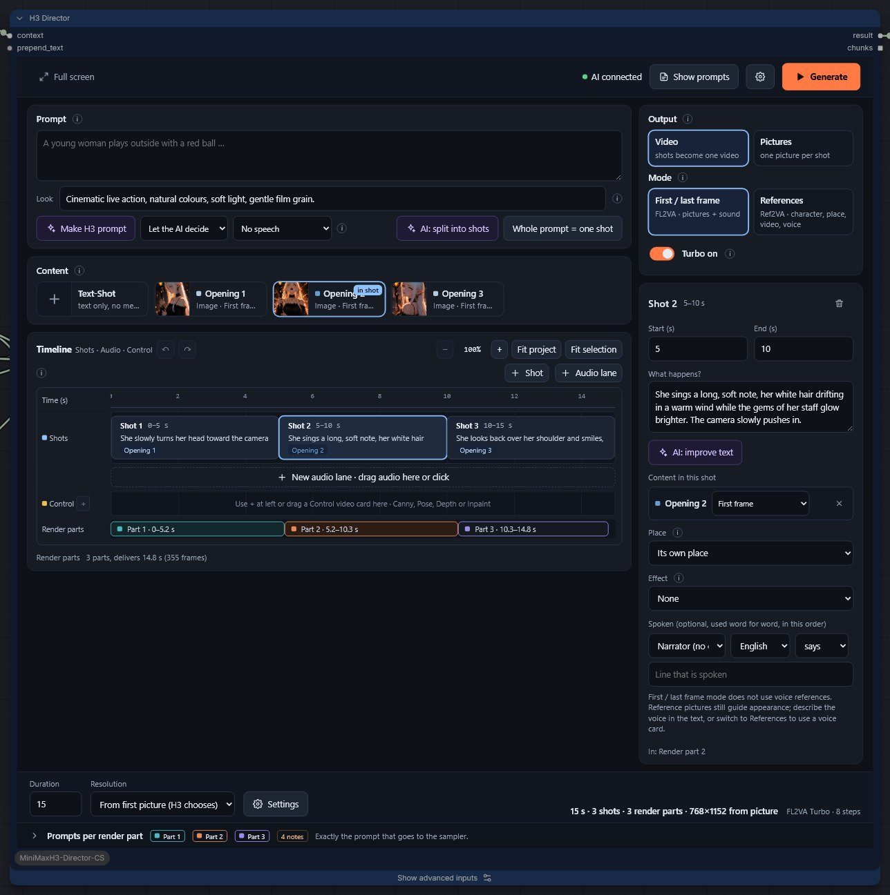

- **Content in this shot**: *Opening 2 — First frame*. Drag a card from **Content** onto a shot to bind it; the role
  (First frame, Last frame, Reference …) can be changed per shot.
- **What happens?**: only what happens after the picture, and how the camera moves.

How the Director renders it: a shot that opens on its own picture starts a render part of its own, so the picture lands
exactly on the first frame. Inside a long shot the next part continues the running take and gets the opening picture as a
reference for faces and clothes, so the look stays the same.

### 4 · Render and save

**H3 Render Sequence** → **Save Video** in `output/H3/`.

### Tips

- Pictures of the same scene in the same light give smooth shot changes.
- A **Last frame** picture on a shot makes the shot end on it.
- Pictures that should only show who someone is (not a frame) belong in Workflow 2 (References).

---

## Workflow 5 · Pictures

The Director can make pictures instead of a video: **one picture per shot**. Good for stills of your character in
different places, for first frames of a later video, or to try a scene quickly.

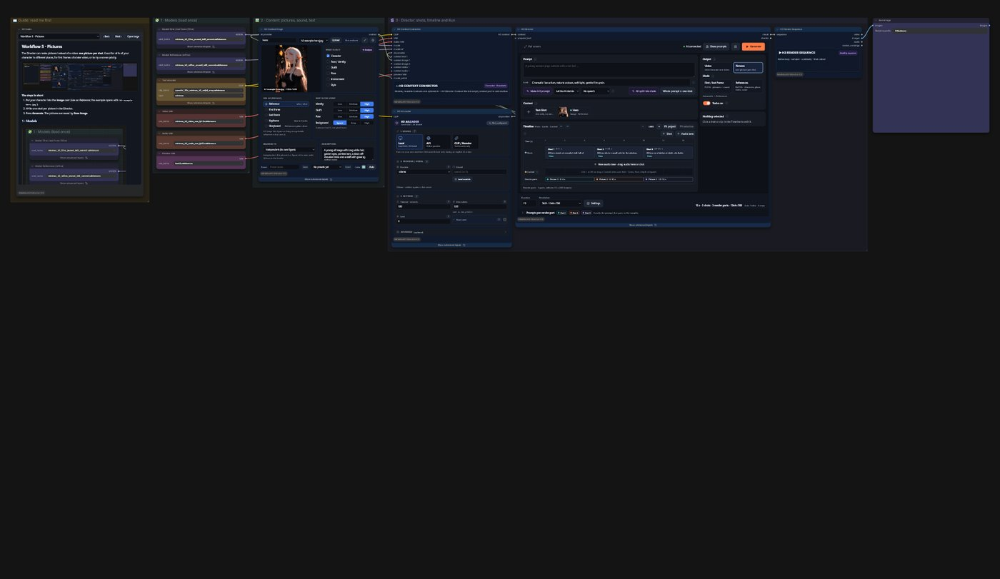

**The steps in short**

1. Put your character into the **Image** card (*Use as: Reference*; the example opens with `h3-example-hero.jpg`).
2. Write one shot per picture in the Director.
3. Press **Generate**. The pictures are saved by **Save Image**.

### 1 · Models

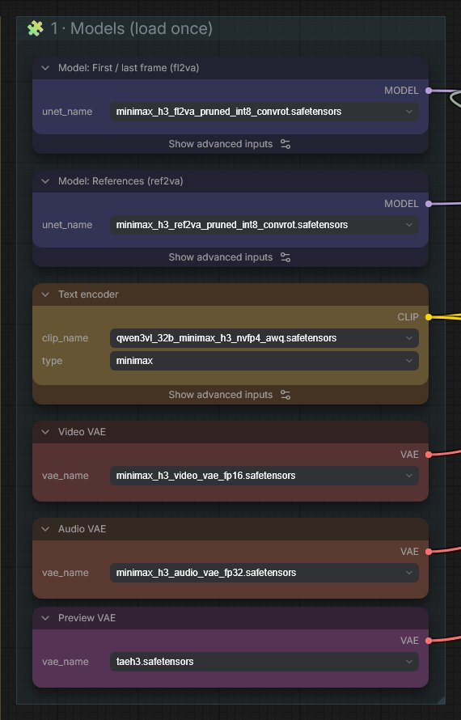

The same six loaders as in every workflow.

### 2 · H3 Director with Output: Pictures

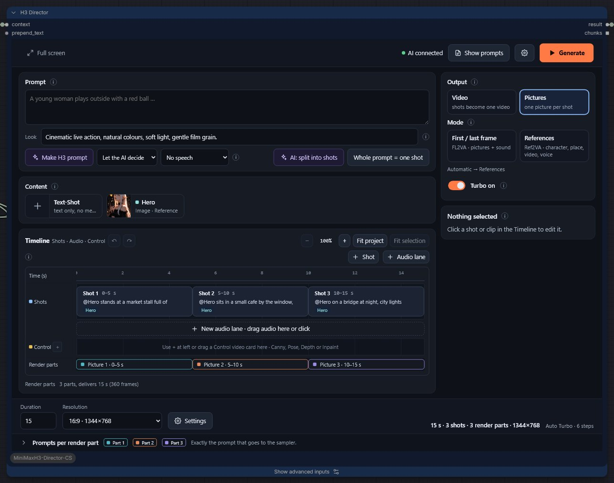

- **Output: Pictures** — every shot becomes one picture. The timeline shows *Picture 1, 2, 3* instead of render parts.
- **Resolution** at the bottom: here 1344×768 (16:9). Pictures can be larger than video, up to about 3 megapixels.
- A shot with only text is text-to-image. Cards on a shot are references: a character, an outfit, a place and a pose
  drawing can be put together into one picture.
- A **First frame** picture on a shot is changed as the shot says and otherwise kept. With an edit mask on its card
  (pencil on the Image card → *Mask*) only the masked area changes.

### 3 · H3 Render Sequence and Save Image

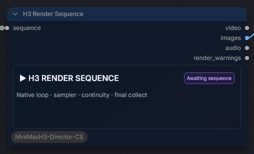

In Pictures mode the Render Sequence gives the pictures on its **images** output.

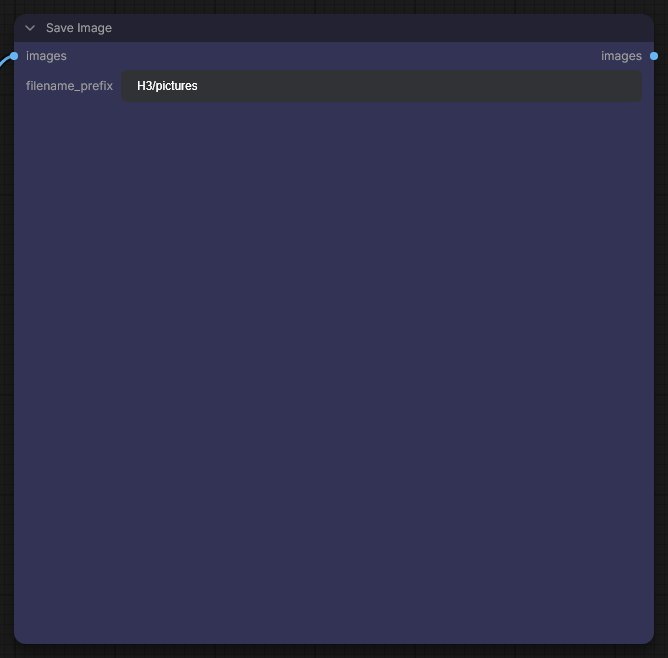

The pictures land in `output/H3/` and are also copied to `input/h3-director-stills`, so every Image card can use them.

### Tips

- With Turbo on a picture takes about 30–45 seconds (measured: 33 s at 3 megapixels, 42 s with four reference pictures).
- A picture you like can open a shot of a video: choose it in an Image card with *Use as: First frame* (Workflow 4).

---

## Workflow 6 · Storyboard

Plan the video as a storyboard sheet first, the way you would sketch it on paper: numbered panels, each with a picture,
a title, a caption and the shot text for H3. The example tells a 20-second story of two characters, **Luna** and
**Inferna**, who meet in a candle-lit hall, show each other their magic and seal a pact.

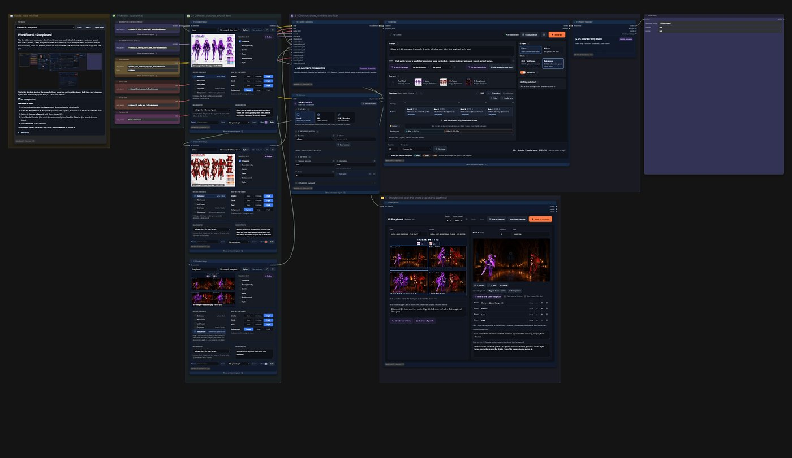

This is the finished sheet of the example. Every panel was put together from a hall, Luna and Inferna as layers, then
redrawn by Qwen Image 2.1 into one picture:

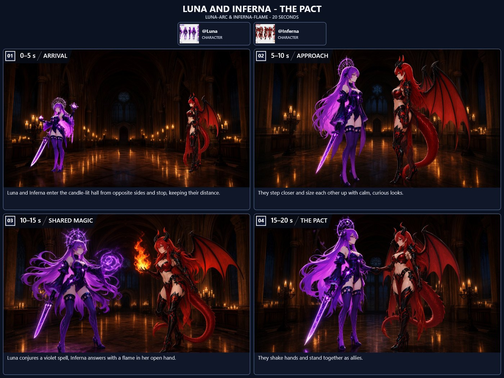

**The steps in short**

1. Put your characters into the **Image** cards (here a character sheet each).
2. In the **H3 Storyboard** fill the panels: pictures, title, caption, shot text — or let the AI write the texts.
3. Optional: **Redraw all panels** with Qwen Image 2.1.
4. Press **Use in Director** (the sheet becomes a card), then **Send to Director** (the panels become shots).
5. Press **Generate** in the Director.

The example opens with every step done; press **Generate** to render it.

### 1 · Models

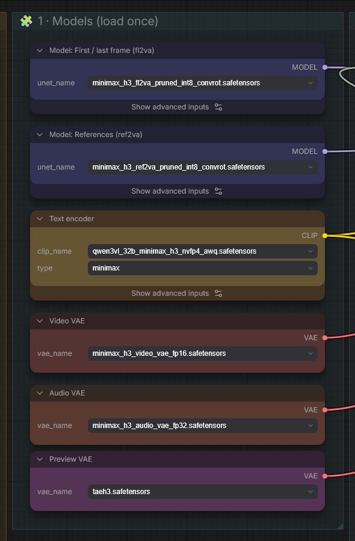

The same six loaders as in every workflow. Drawing with Qwen Image 2.1 and cutting out figures need extra models
(chapter 2); without them you place your own pictures.

### 2 · Content: two characters and the sheet

The **Luna** and **Inferna** cards hold a character sheet each (*Use as: Reference*). A sheet with front, side and back
keeps the figure the same from every angle. The third card is made by **Use in Director**: the drawn storyboard sheet,
*Use as: Storyboard*.

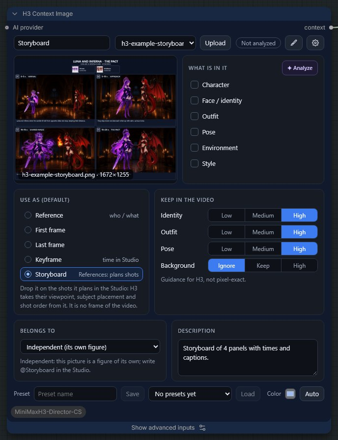

### 3 · H3 Storyboard

The storyboard has its own group below the Director. It is wired by one cable: **H3 context** from the Connector.

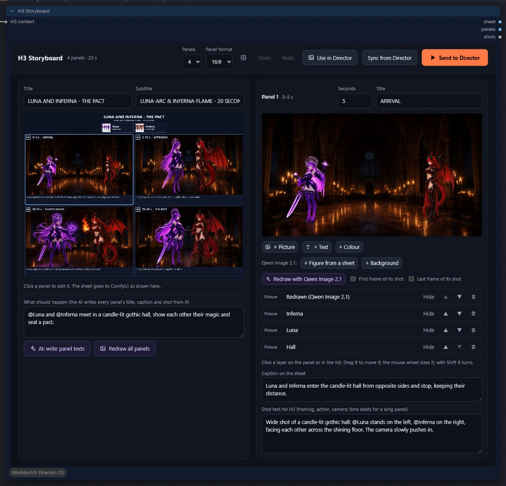

- **Top:** number of **Panels** (1–9), **Panel format** (16:9, 9:16, 1:1, 4:3, 3:4, 21:9), the gear (models), Undo /
  Redo and the three buttons to the Director.
- **Left:** **Title** and **Subtitle**, the sheet as it will be drawn (click a panel to edit it), and **What should
  happen** with **AI: write panel texts** and **Redraw all panels**.
- **Right:** the selected panel: **Seconds**, **Title**, its picture, the buttons to add layers, the layer list, the
  **Caption on the sheet** and the **Shot text for H3**.

#### Pictures on a panel

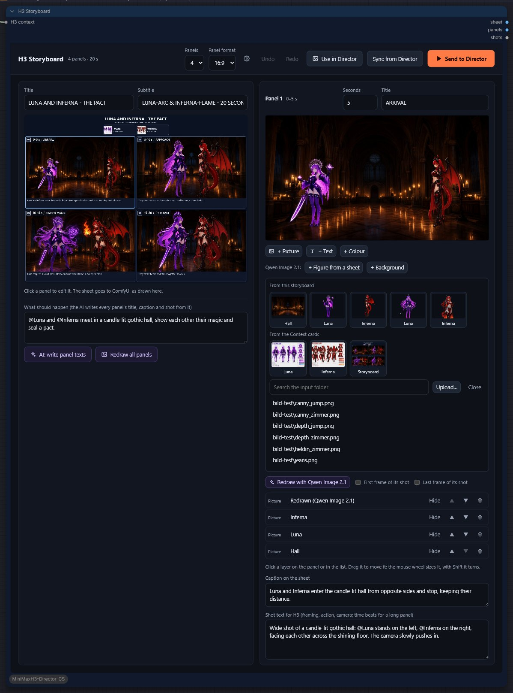

**+ Picture** offers your Context cards, the pictures this storyboard already made (*From this storyboard*), every
picture of the input folder (with search) and **Upload…**. You can also drag picture files from a folder straight onto a
panel.

#### Figures and backgrounds with Qwen Image 2.1

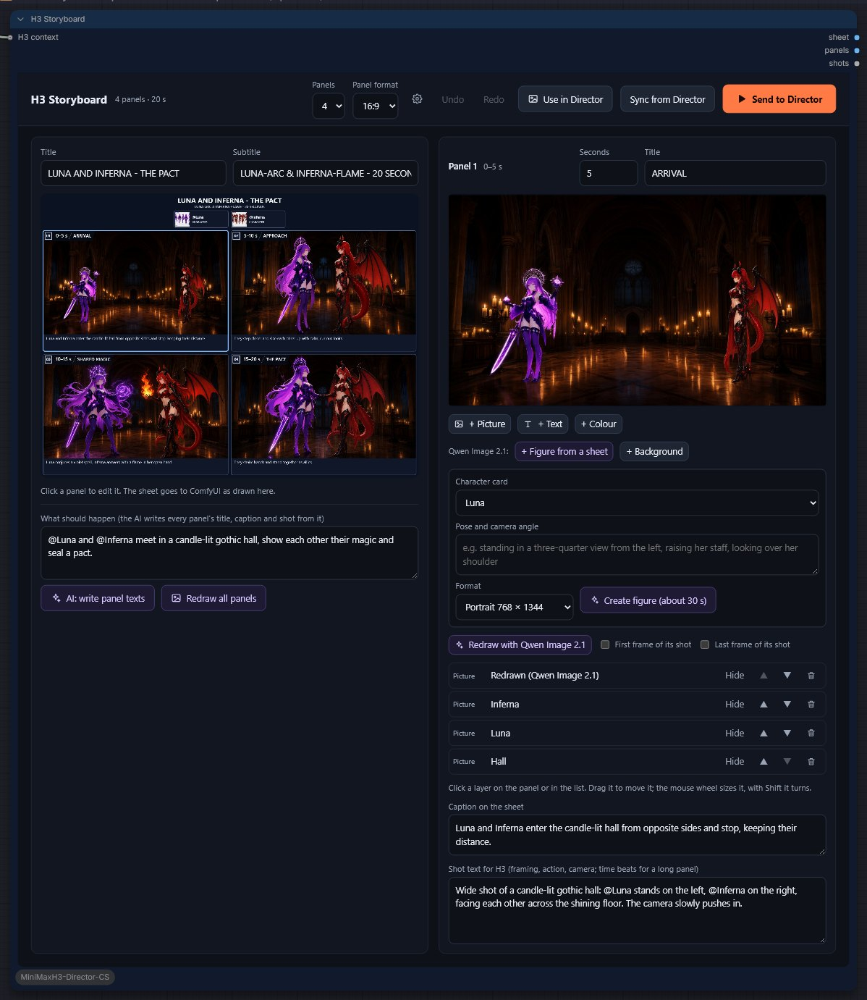

**+ Figure from a sheet** draws a character card's figure in the pose and camera angle you write, without background
(portrait, square or landscape, about 30 s).

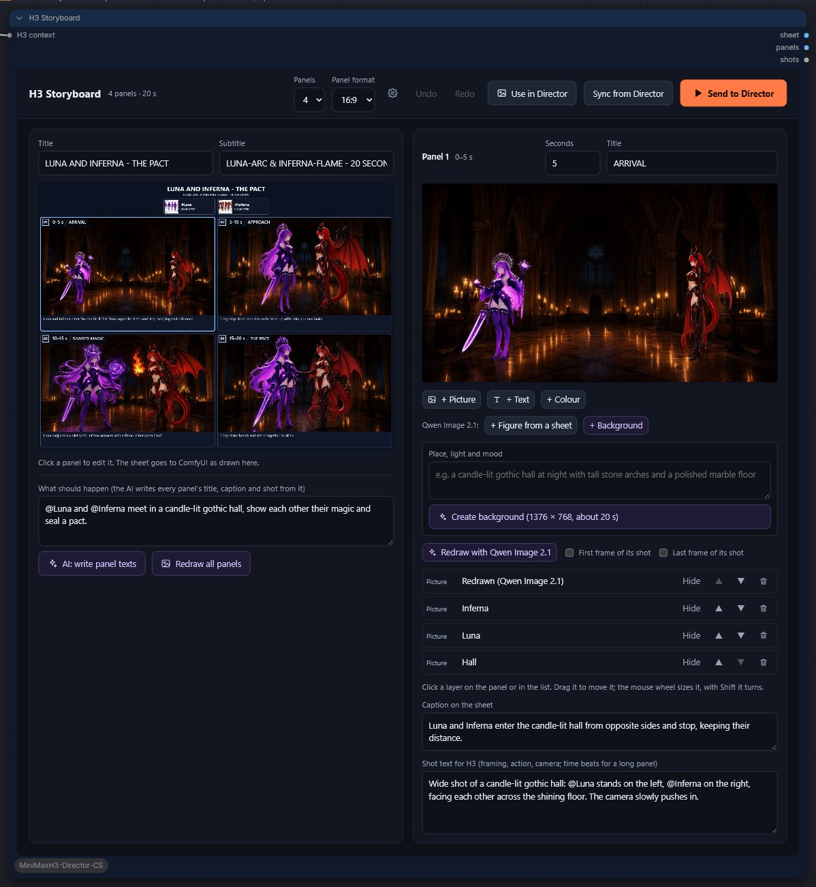

**+ Background** draws an empty place in the panel's format from your description of place, light and mood (about 20 s).
Both land on the panel and in *From this storyboard* for every other panel.

#### Layers

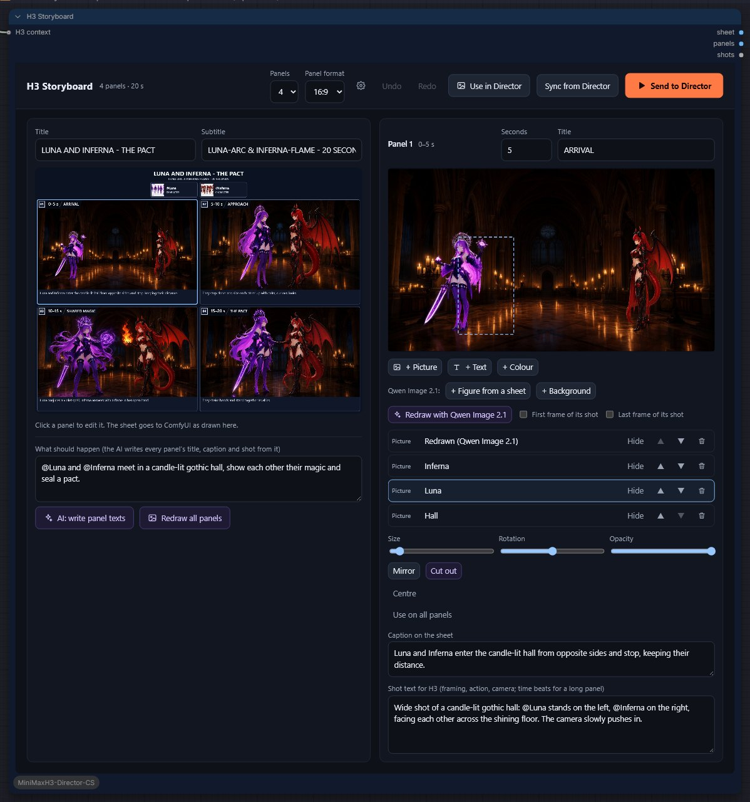

Click a layer on the panel or in the list. Drag it to move it; the mouse wheel sizes it, with **Shift** it turns. Below
the list: **Size**, **Rotation**, **Opacity**, **Mirror**, **Cut out** (removes the background), **Centre** and **Use on
all panels** (the same layer at the same place on every panel). The arrows put a layer in front or behind; **Hide**
keeps it but does not draw it.

#### Redraw with Qwen Image 2.1

**Redraw with Qwen Image 2.1** (one panel) or **Redraw all panels** paints the collage anew as one finished picture: the
collage keeps the composition, the character cards the panel names are the references. The result is a new layer on
top; the collage stays below it — hide the new layer or press Undo to go back. About a minute per panel.

#### Models of the storyboard

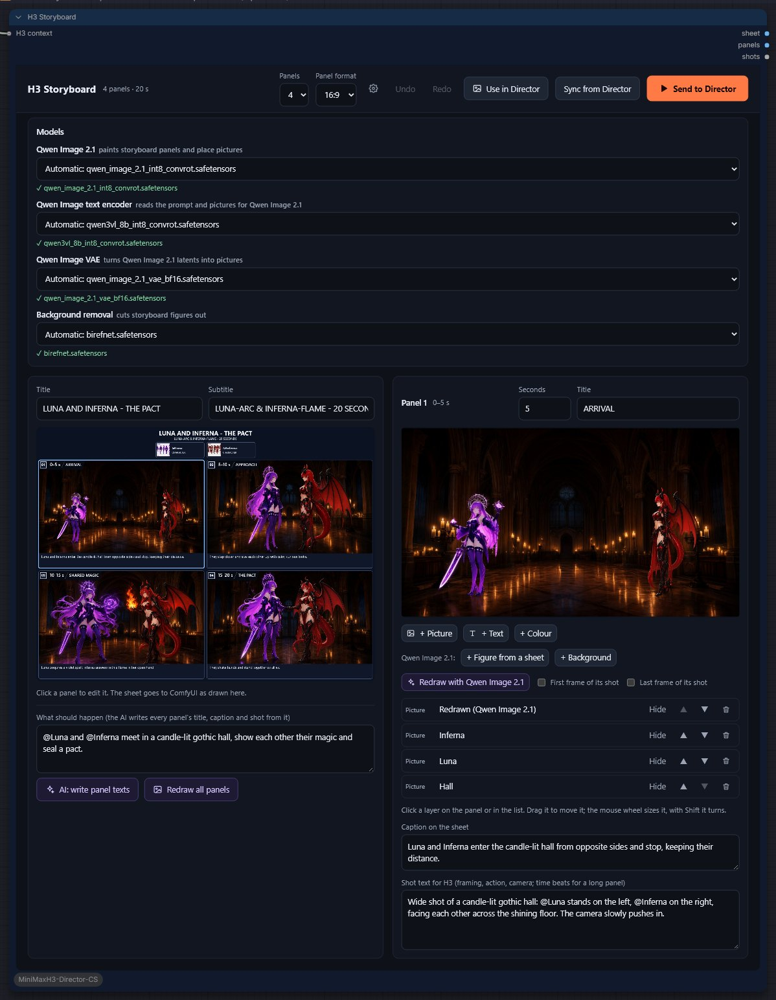

The gear shows which Qwen Image 2.1 and background-removal files were found, with their download links.

### 4 · Into the Director

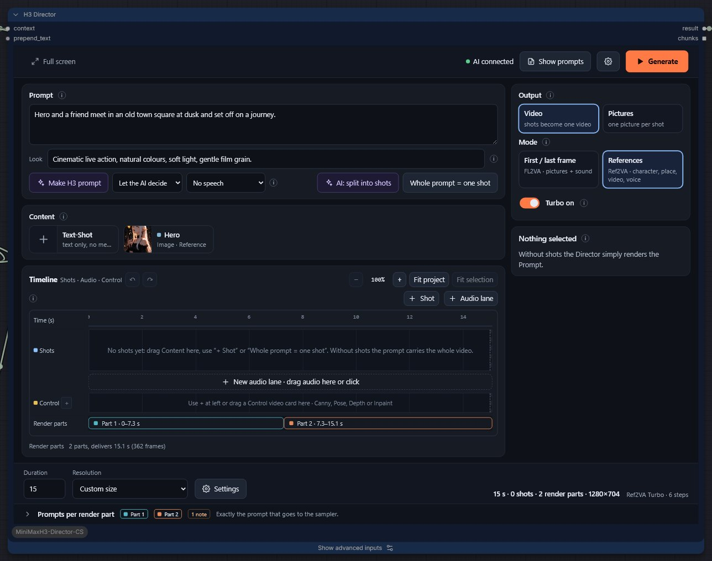

- **Use in Director** draws the sheet into `input/h3-storyboard` and adds it as a card at the Connector.
- **Send to Director** turns the panels into shots: the times, the shot texts, the sheet on every shot (role
  *Storyboard*) and, for panels marked **First frame / Last frame of its shot**, the panel's picture as that frame. The
  Director's sound lanes, Look and Prompt stay; it asks before replacing its shots.
- **Sync from Director** brings lengths and texts you changed in the Director back into the panels.

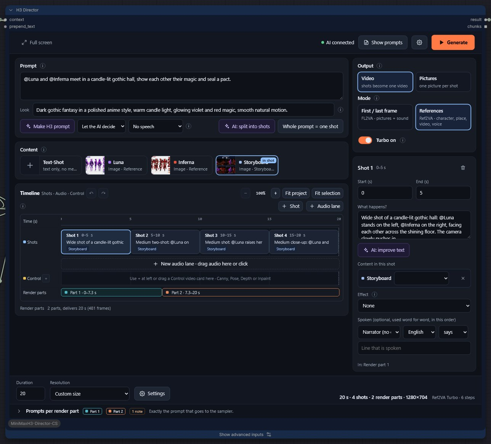

### Tips

- A storyboard plans shots in **References** mode; the sheet is a plan for H3, not a picture that appears in the video.
- Name the characters in the shot texts (`@Luna`, `@Inferna`) and say who stands where: the order comes from the text.
- Four to six panels for 10–30 seconds; more panels make very short shots.
- The drawn sheet (PNG) carries the whole storyboard. Drag it onto an H3 Storyboard to get every panel and layer back —
  try it with `h3-example-storyboard.png` from the input folder.

---

## Workflow 7 · Control video (pose, canny, depth)

Your character moves like the person in another video. A **control video** (pose skeletons, edges or depth) steers the
movement through the official H3 ControlNet; your Image card decides who is seen.

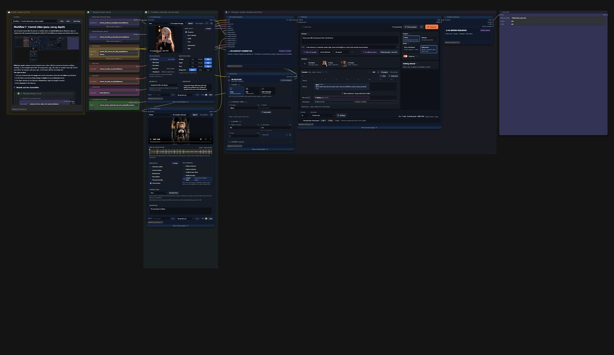

**What you need:** a picture of your character and a video with the movement (a person walking, dancing …).
The example opens with `h3-example-hero.jpg`, the walk `h3-example-walk.mp4` and its pose video `h3-example-walk-pose.mp4`, so it renders without converting first.

**The steps in short**

1. Put your character into the **Image** card and the movement video into the **Video** card (*Motion*).
2. In the Video card choose **Pose**, **Canny** or **Depth** and press **Generate** (once).
3. The clip is already on the Director's **Control** lane; adjust its length if needed.
4. Press **Generate** in the Director.

### 1 · Models and the ControlNet

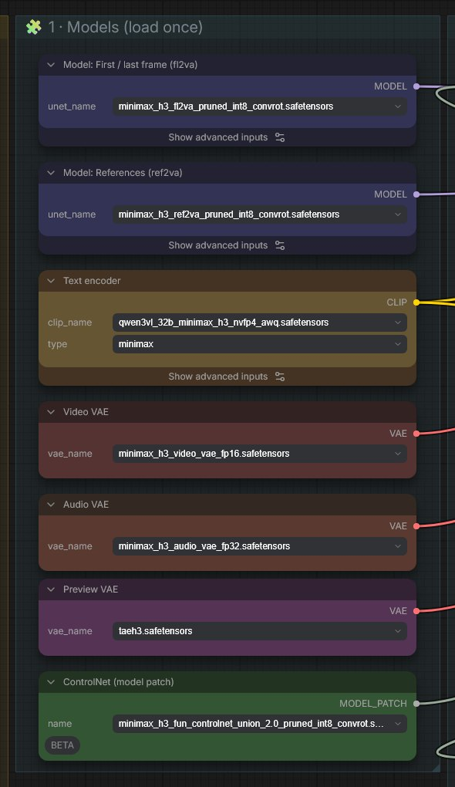

Next to the six usual loaders the green **ControlNet (model patch)** loader loads the official H3 ControlNet:

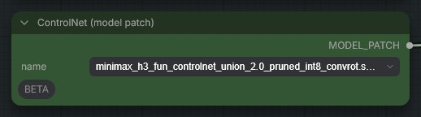

| File | Folder |
|---|---|
| `minimax_h3_fun_controlnet_union_2.0_pruned_int8_convrot.safetensors` | `models/model_patches` |

It is connected to the Connector's **model_patch** input.

### 2 · The control video card

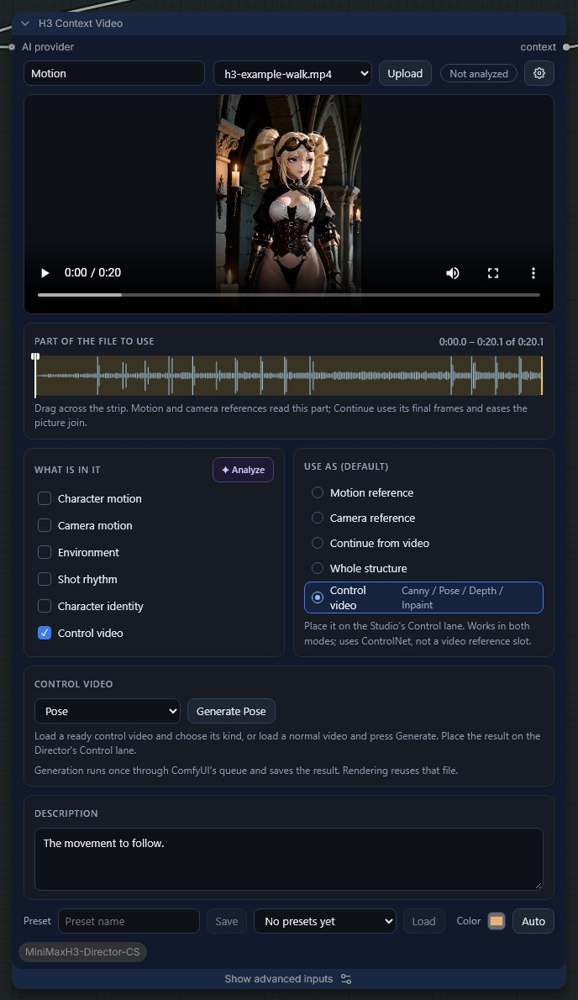

- **Use as: Control video**.
- **Control video**: *Pose* (skeletons of the person), *Canny* (edges) or *Depth*. **Generate Pose / Canny / Depth** runs
  once through ComfyUI's queue and saves the result in `input/h3-control`; rendering reuses that file. A ready control
  video can also be chosen directly.
- **Part of the file to use**: drag across the strip to use only a part of the video.

Extra models for the conversion (the gear of the card shows what was found):

| Kind | Needs |
|---|---|
| Canny | nothing extra |
| Pose | `rt_detr_v4-x-hgnet_fp16.safetensors` (`models/diffusion_models`) and `sdpose_wholebody_fp16.safetensors` (`models/checkpoints`) |
| Depth | `moge_2_vitl_normal_fp16.safetensors` (`models/geometry_estimation`) |

### 3 · H3 Director

The **Control** lane under the shots holds the control clip (*Motion · pose · 0–10 s*). Drag a Video card with *Control
video* onto the lane to add one; move or trim clips with the mouse. Control works in **both modes**.

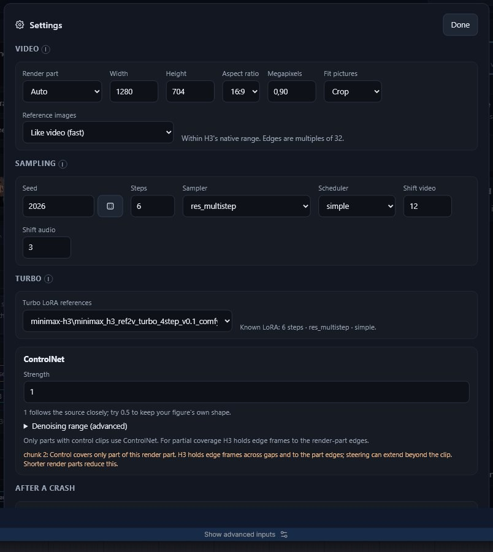

In **Settings → ControlNet**: **Strength** 1 follows the source closely; 0.5 keeps more of your figure's own shape.
**Denoising range** (advanced) is a share of the sampling steps, not of video time.

### Tips

- ControlNet works on whole render parts. If a clip covers only part of a render part, its first or last frame is held to
  the edges; the Studio warns about it. Let clips cover whole parts, or make the parts shorter.
- The figure in the control video and yours should have a similar build; strength 0.5–0.7 helps when they differ.

---

## Workflow 8 · Inpaint: replace a figure

A person in your footage is replaced by your character; the rest of the video (the place, the light, the camera) stays. A **mask
video** marks the area to redraw: white is regenerated, black is taken from the footage.

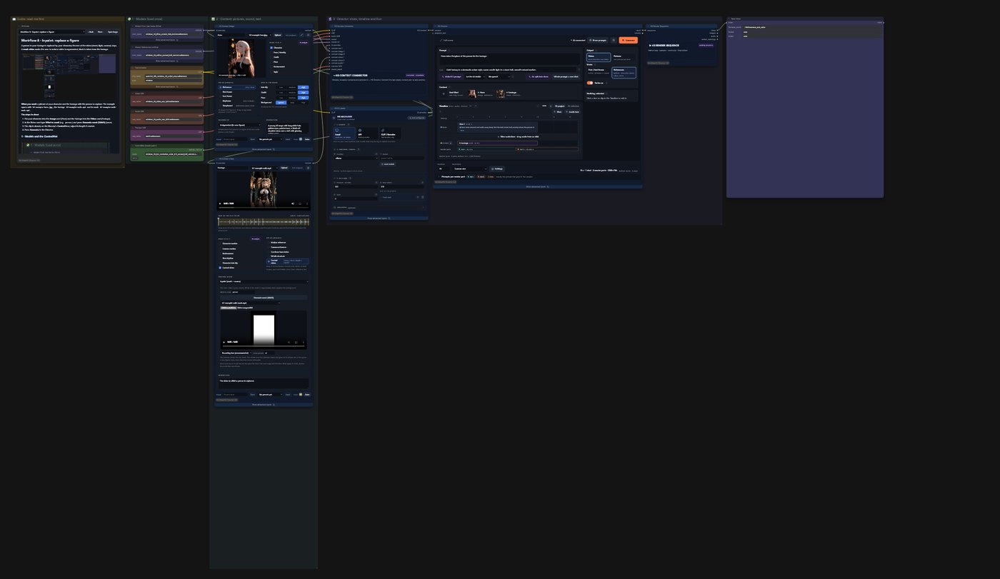

**What you need:** a picture of your character and the footage with the person to replace.
The example opens with `h3-example-hero.jpg`, the footage `h3-example-walk.mp4` and its mask `h3-example-walk-mask.mp4`.

**The steps in short**

1. Put your character into the **Image** card (*Hero*) and the footage into the **Video** card (*Footage*).
2. In the Video card type **What to mask** (e.g. `person`) and press **Generate mask (SAM3)** (once).
3. The clip is already on the Director's **Control** lane; adjust its length if needed.
4. Press **Generate** in the Director.

### 1 · Models and the ControlNet

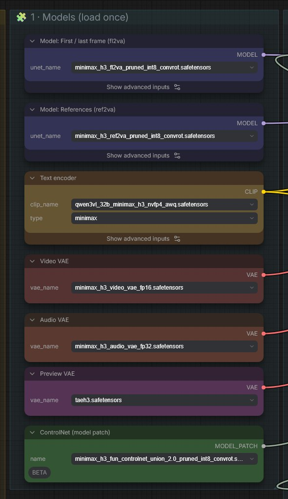

The same loaders as in Workflow 7, including the **ControlNet (model patch)** loader with
`minimax_h3_fun_controlnet_union_2.0_pruned_int8_convrot.safetensors` on the Connector's **model_patch** input.

For the mask you also need **SAM3**: `sam3.1_multiplex_fp16.safetensors` in `models/checkpoints`. It is only used when
you press *Generate mask*; rendering does not load it.

### 2 · The footage card

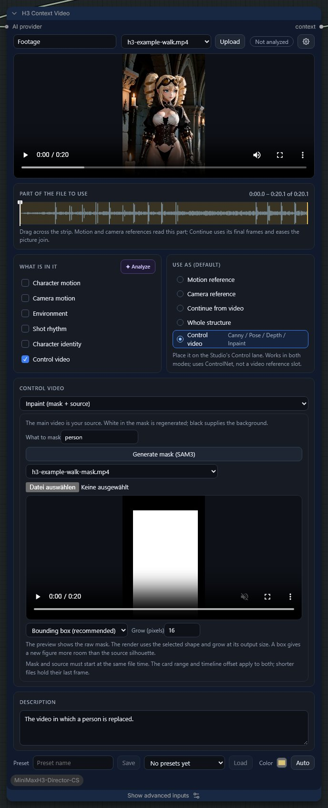

- **Use as: Control video**, **Control video: Inpaint (mask + source)**. The card's own video is the source.
- **What to mask**: what SAM3 should find, e.g. `person`, `woman in red`, `dog`. **Generate mask (SAM3)** saves a black
  and white mask video next to the source. A ready mask video can also be chosen or uploaded.
- The preview shows the raw mask. The shape for rendering is chosen below it:
  - **Bounding box** (recommended): a box around the figure, so the new figure may be wider, taller or differently dressed.
  - **Silhouette**: only the outline of the found figure; for a very similar figure.
  - **Grow (pixels)**: widens the mask at the render size; 16 by default.
  Changing the shape or Grow does not run SAM3 again.
- Mask and source must start at the same time in the file. The card's range and the clip's offset apply to both; a
  shorter file holds its last frame.

### 3 · H3 Director

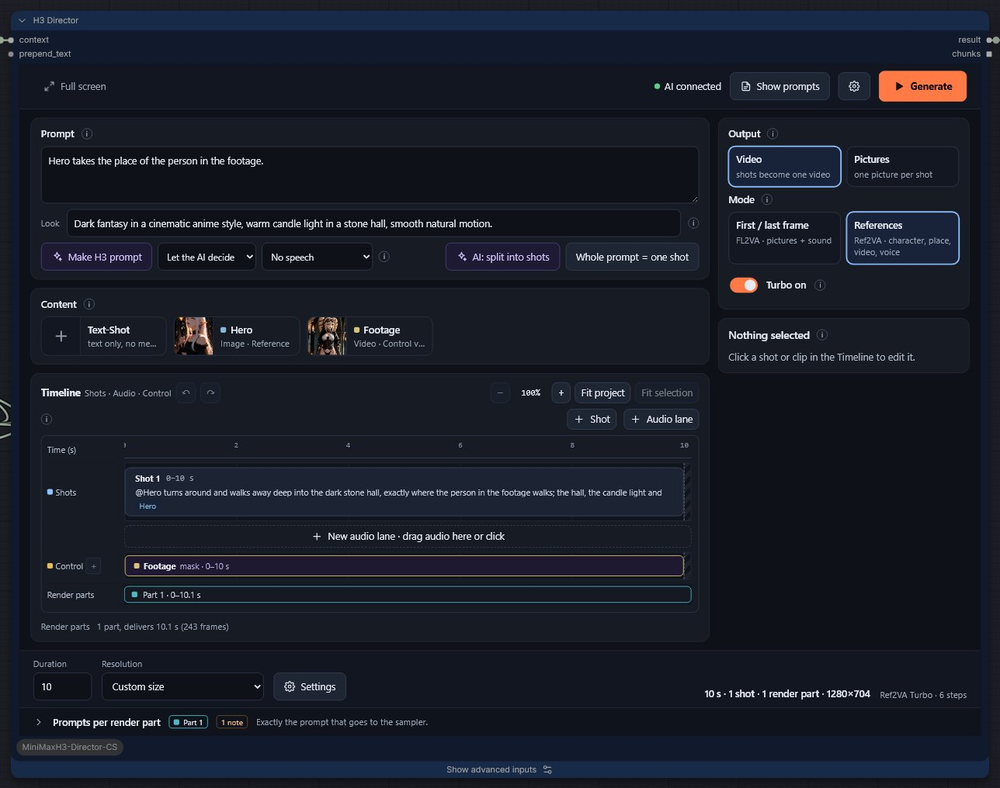

- **Mode: References** — your character's picture is the reference for the new figure.
- The **Control** lane holds the clip *Footage · mask · 0–10 s*.
- The shot names the character: *@Hero turns around and walks away deep into the dark stone hall, exactly where the
  person in the footage walks …*. Describe the scene as it is in the footage, so the new figure fits into it.

### Tips

- Describe in the shot what the person in the footage does (walk, turn, sit down); the mask only says *where*.
- After changing the footage, generate or choose its matching mask again.
- If parts of the old person stay visible, raise **Grow** or switch to **Bounding box**.
- Inpaint and other control clips (pose, depth) can follow each other on the Control lane.

---

## Workflow 9 · Custom sampling (advanced)

The same lighthouse video as Workflow 1, but instead of **H3 Render Sequence** you see the sampling itself: ComfyUI's own
loop runs once per render part, with ordinary sampler nodes you can change or extend.

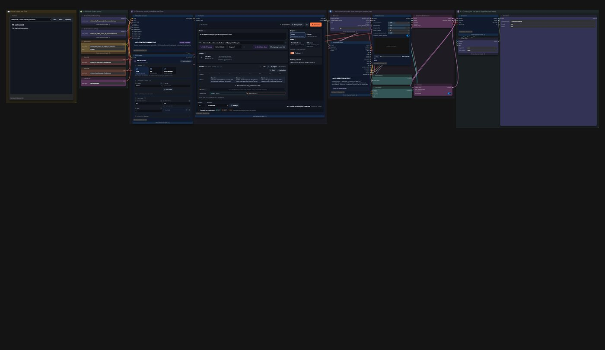

Use it when you want your own sampler, a second sampling stage, a different guider or your own preview. For everything
else the Render Sequence of the other workflows is simpler and does the same.

### 1 · Models and Director

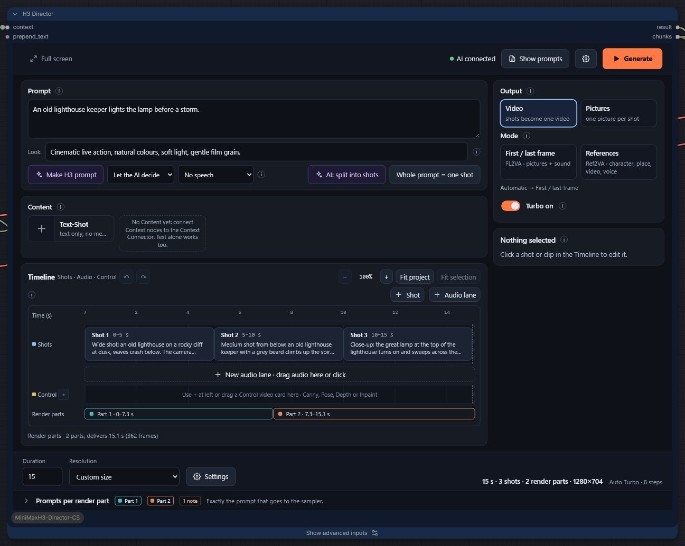

The six loaders, the Connector and the Director are the same as in Workflow 1. The Director has two outputs: **result**
(the whole plan) and **chunks** (the list of render parts).

### 2 · Your own sampler: one pass per render part

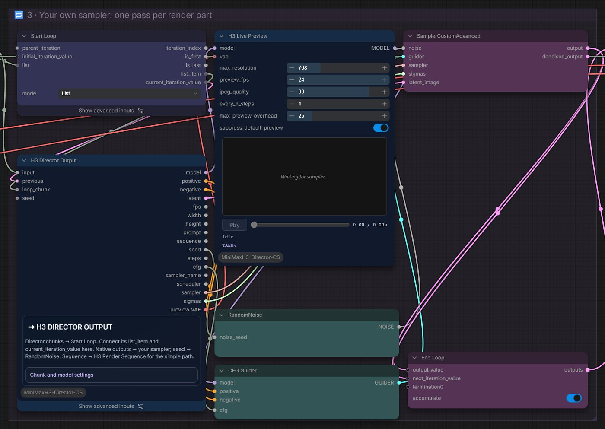

| Node | What it does |
|---|---|
| **Start Loop** (List) | takes the Director's **chunks** and runs the body once per render part; *list_item* is the current part, *current_iteration_value* the latent of the part before |
| **H3 Director Output** | prepares the current part: MODEL (with the turbo LoRA when Turbo is on), positive and negative conditioning, the empty AV latent, the **seed**, and the Director's **cfg**, **sampler** and **sigmas** |
| **H3 Live Preview** | puts the live preview (taeh3) on the model, so you see each part while it is sampled |
| **RandomNoise** | noise from Output's seed (the Director's seed plus the part's number) |
| **CFGGuider** | the guider; cfg comes from Output and is always 1 for H3 |
| **SamplerCustomAdvanced** | samples the part with Output's sampler and sigmas |
| **End Loop** | collects every part's finished latent (*accumulate* on) and hands it to the next part, which continues from its end |

Rules for your own changes:

- Keep everything that uses Output's values **inside** the loop. A link from inside the loop to a node outside it is
  refused by ComfyUI ("loop boundary").
- Return the **complete** audio-video latent of each part to both inputs of End Loop; the next part needs it to
  continue picture and sound.
- With two sampling stages (SplitSigmas), give the second stage the first stage's output and DisableNoise; use Output's
  model in both. A locked song stays locked in every stage.

### 3 · Output: put the parts together and save

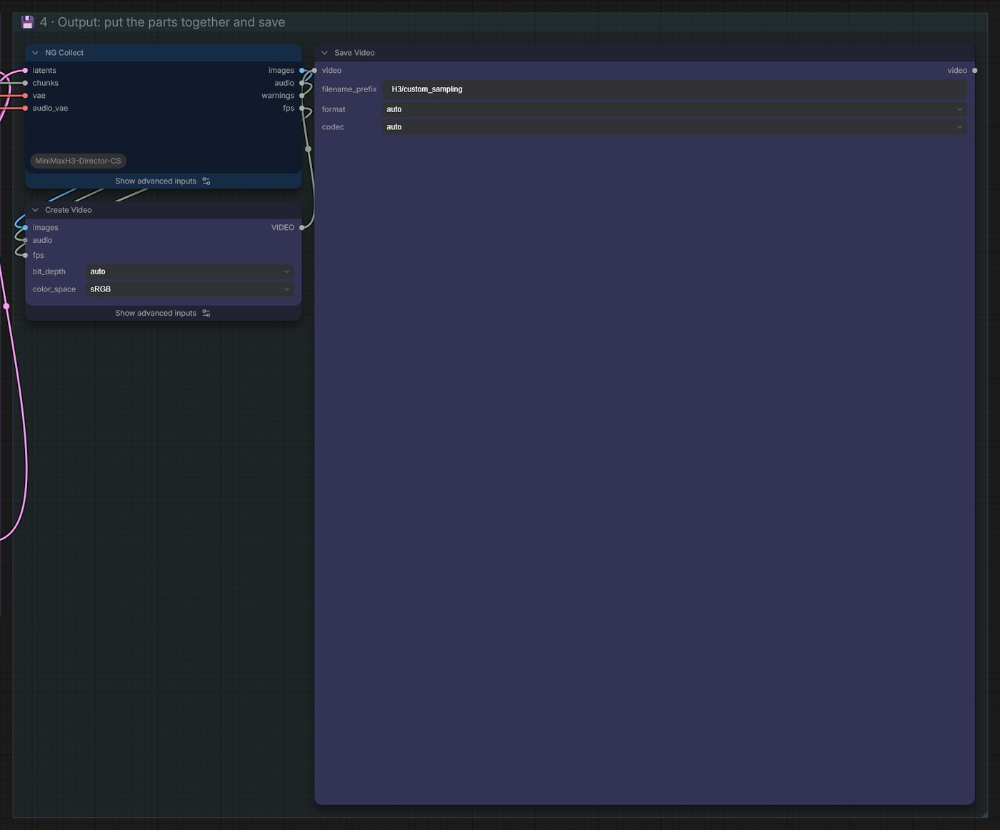

- **NG Collect** decodes all parts with the video and audio VAE, removes the overlap each part repeated from the one
  before and joins picture and sound. Its **fps** output (24) goes to CreateVideo.
- **CreateVideo** → **Save Video** writes `output/H3/custom_sampling_00001_.mp4`.

For a long video (a whole song) use **NG Collect Video** instead of NG Collect: it writes the file part by part and
needs far less memory.

### Tips

- The Director's Steps, Sampler and Scheduler (or the turbo LoRA's) arrive through Output; change them in the Studio,
  not in the sampler nodes.
- Resume after a crash is a feature of the Render Sequence; this loop renders every part again.

---

## The Studio: shots and timeline

The H3 Director node **is** the Studio: everything is edited inside the node and saved with the workflow.

### Header

- **Full screen** lifts the Studio over the whole window; **Esc** or **Back to graph** puts it back.
- **AI connected** shows that an H3 AI Loader is ready (chapter *Writing with the AI*).
- **Show prompts** opens *Prompts per render part* at the bottom.
- The **gear** opens the Settings (chapter *Settings*).
- **Generate** queues the workflow, the same as ComfyUI's Run.

### Prompt, Look and Content

- **Prompt**: what the video is about. Without shots the Prompt alone is enough for a text video.
- **Look**: what every render part shares — style, place, light.
- **Make H3 prompt**, **AI: split into shots** and **Whole prompt = one shot** turn the Prompt into shots (the first two
  need the AI).
- **Content**: one card per Context node on the Connector, plus a plain **Text-Shot**. Drag a card onto the empty
  timeline to make a shot with it, onto a shot to use it there, or an audio card onto an audio lane. Cards the current mode
  cannot use are dimmed.

### Timeline

All lanes share one time axis on a 0.1 s grid. **−** / **+** zoom, **Fit project** shows everything; the arrows are Undo
and Redo.

- **Shots**: drag a shot to move it, drag its edges to change start or end, drop it on another shot to change the order.
  **+ Shot** adds a 4 s shot after the selected one.
- **Audio lanes**: a sound on a lane runs on its own, across shots and render parts (a song is not restarted per shot).
  **+ Audio lane** adds one; move and trim the clip with the mouse.
- **Control**: control videos and masks (Workflows 7 and 8).
- **Render parts**: how the Director cuts the video into H3 runs, each in its own colour. You do not edit them; they follow
  the shots, the duration and the render-part length in the Settings.

### The right side

**Output** (*Video* or *Pictures*), **Mode** (chapter *References or first frames*) and **Turbo**. Below it the selected
item:

- **A shot**: start and end, **What happens?** (the action and the camera, `@Name` for a card), **Content in this shot**
  with the role of each card, and the **Spoken** lines. **AI: improve text** suggests a better shot text. **Place**
  reuses the place of an earlier shot (chapter *Pictures*); **Effect** adds an official H3 camera effect such as *Bullet
  time*, when its files are installed.
- **An audio clip**: its time on the story, **From second in file** and how H3 uses it (*Lock*, *Copy*, *Reference*,
  chapter *Voices, dialogue and songs*).
- **A control clip**: its time and offset in the file.

### Bottom

**Duration** in seconds (a button such as **= Song** takes the length of that audio card), **Resolution** (*Native*, *Fast*, *Above native*,
*From first picture* or a custom size) and **Settings**. On the right a summary: length, shots, render parts, size, mode
and steps.

### Prompts per render part

Exactly the prompt each render part sends to H3, in the part's colour, with the planner's notes. A badge says where it
comes from: compiled, AI-written, edited or manual.

- **Write with AI** / **Write all parts with AI** lets the AI write the part out in full; the timing, the names and the
  spoken lines stay the planner's.
- **Edit** writes the part yourself; **Reset** returns to the compiled prompt.
- When the shots of a part change later, its own prompt is marked *outdated* and the compiled one is used again.

### How to write a shot

- Start with the framing (*Medium shot*, *Close-up from below*), then the action, then **one sentence for the camera**
  (*The camera tracks beside her*, *Static shot*). Without a camera sentence H3 chooses its own and may cut away.
- Say clearly in which direction someone moves.
- A shot longer than 5 s can be written in time beats: `0–4s: … 4–8s: …`.
- A new action needs about two seconds after a shot starts.
- A change of view is a new shot; the Director adds the cut.

---

## Content cards

Every picture, video, sound and note is a **card**: an H3 Context node connected to the Context Connector. The card says
**what** the material is and **who** it belongs to; **when** it plays is set in the Studio.

### What every card has

- **Name** (top left): used as `@Name` in the shots. Renaming a card renames its mentions too.
- **File** with **Upload**, or drop a file onto the card. Files come from ComfyUI's `input` folder.
- **What is in it** and **✦ Analyze**: the AI suggests the content, the role and a description; nothing changes until you
  press **Accept**.
- **Use as (default)**: the card's role, unless a shot in the Studio gives it another one. The hint below warns when a
  role does nothing in the Director's mode.
- **Description**: one sentence of what is seen or heard. H3 reads it with the medium.
- Where a card is used shows in the Director's shots and lanes. A card that no shot uses is part of every render part.
- **Preset** (save and load the card's settings) and **Color**.

### Image

| Use as | What it does |
|---|---|
| Reference | keeps the figure, outfit or place recognizable (References mode) |
| First frame / Last frame | the shot (or the video) starts or ends on this picture |
| Keyframe | the picture is reached at a time inside a shot (set the time in the Studio) |
| Storyboard | a storyboard sheet that plans the shots (References mode) |

- **Keep in the video**: how strictly H3 keeps identity, outfit, pose and background. It guides H3; it is not pixel-exact.
- **Belongs to**: a second picture of the same figure (side, back, an outfit) belongs to the first one; otherwise H3 sees
  two people.
- The **pencil** opens the picture editor (chapter *Pictures and the picture editor*).

### Video

| Use as | What it does |
|---|---|
| Motion reference | H3 copies the kind of movement |
| Camera reference | H3 copies the camera movement |
| Continue from video | the new video continues the end of this one (its last frames are hidden context) |
| Whole structure | movement, camera and rhythm together |
| Control video | pose, edges, depth or a mask steer the picture exactly (Workflows 7 and 8) |

**Part of the file to use**: drag across the strip. **Its own sound**: send the video's sound along or ignore it.

### Audio

| Use as | What it does |
|---|---|
| Voice | the voice of a figure (choose it in **Whose voice**) |
| Copy | H3 is asked to reuse the sound as closely as it can |
| Lock | the sound is kept exactly (songs) |
| Music style / Rhythm / Sound reference | mood and style only |

The range above the waveform is the part that is used. **Listen here** only changes playback in the browser. **Lyrics**:
see chapter *Voices, dialogue and songs*.

### Text

A note in any language. **Scene / story** is read like the Prompt; every other role (*Style / direction*, *Rule*,
*Character*, *World lore*, *Camera rule*, *Dialogue rule*, *Constraint*, *General*) goes into every render part. **Quick
insert** adds common lines.

### Several cards, one file

One file can be used by several cards, each with its own name, range and role — for example the same song once as
*Lock* for the sound and once as *Music style*.

---

## References or first frames

H3 has two models. The **Mode** in the Director chooses which one renders the project.

| Mode | H3 model | Your pictures are … | Good for |
|---|---|---|---|
| **References** (Ref2VA) | `minimax_h3_ref2va` | references: who is seen, what they wear, where | characters, voices, songs, several figures |
| **First / last frame** (FL2VA) | `minimax_h3_fl2va` | the exact first or last frame of a shot | shots from your pictures, text-only videos |

### References

- Pictures, videos and voices are references. A figure stays recognizable in every shot, from any angle the shot asks for.
- Up to several figures, outfits, places and a voice per figure.
- A **First frame** picture still works here, as a timed guide; it is close to the picture, not pixel-exact.
- A **Storyboard** card plans the shots (Workflow 6).

### First / last frame

- A shot with a **First frame** picture starts exactly on it; a **Last frame** picture ends it.
- A **Keyframe** is reached at its time inside a shot: the Director ends a render part on it and the next part continues
  from there. It moves by up to a third of a second to H3's frame grid.
- A **Reference** picture stays a reference next to the frames: it keeps the face and clothes the first frame does not
  show.
- Without any picture (text only) the Director uses this model.
- Sound can only be locked here, not copied or used as a voice.

### Automatic

Older workflows may show *Automatic*. Then the Director decides by the cards: a Reference picture or a voice chooses
References, otherwise First / last frame. Set the mode yourself when you know what you want.

### Which one?

- Your character should **look the same** in different places → **References**.
- A shot should **start exactly** on a picture you made → **First / last frame**.
- Both in one video: make the pictures in **Pictures** output first (Workflow 5), then use them as first frames.

---

## Voices, dialogue and songs

H3 makes picture and sound together. Without any sound file it still makes sound: steps, wind, voices. Sound files and
spoken lines tell it more.

### Spoken lines

In a shot, **+ Spoken line** adds a line that is said **word for word**:

- **Speaker**: a figure (a card), or *Narrator* for a voice without a picture.
- **Language**: the language the line is spoken in.
- **Delivery**: *says*, *sings*, *whispers*, *shouts* or *murmurs*. A sung line needs *sings*.
- Several lines in one shot are said in their order. Short lines (one sentence per 2–3 seconds) come out best.

### A voice for a figure

Put a short sound file of the voice (3–10 s of clean speech, no music) into an **Audio** card:

- **Use as: Voice**, **Whose voice**: the figure. Every line of that figure uses this voice (References mode).

### Sounds on audio lanes

Drag an Audio card onto an **audio lane** in the timeline. A clip on a lane plays on its own time, across shots and render
parts. Click the clip to choose how H3 uses it:

| Role | What happens |
|---|---|
| **Lock exactly** | the sound is kept exactly as it is; H3 makes the picture to it (songs, a finished sound track) |
| **Copy as closely as possible** | H3 is asked to reuse the sound; it may change |
| **Reference only** | only mood, voice and style |

**From second in file** chooses where in the file the clip starts. In First / last frame mode a clip can only be locked.

### Songs

1. Audio card: **What is in it: Music**, **Use as: Lock**, **Whose voice**: the singer.
2. The button with the card's name next to *Duration* (e.g. **= Song**) makes the video as long as the song.
3. **Lyrics** (optional): one sung line per row. **⟳ Time with Whisper** finds when each line is sung (it needs the Whisper
   model, chapter 2); **Stamp line** sets the selected line's time by ear while the song plays. Each render part then gets
   only the lines sung in it, so the lips match.

A locked song stays exact in every render part: when the parts are put together, the original sound is laid back over
the locked span, so it does not get dull at the joins.

### Ambience and music

In **Settings → Sound, style and transitions**:

- **Ambience**: the background sound of every part, e.g. *Footsteps on cobblestones, distant voices*.
- **Music**: background music in words, or *N/A* for none.
- **Transition between render parts**: *Continue picture and sound* (default) carries about a second of sound into the
  next part, so it runs on without a break.

### Tips

- A spoken line that H3 does not say is often too long for its shot: give it more time or split it.
- Music or noise in a voice sample changes the voice.
- Words in quotes in the Prompt are kept as they are when the AI writes the shots.

---

## H3 Director: all settings

Every field of the H3 Director in one place, from top to bottom. How to work with shots and the timeline is in chapter
*The Studio*; every field also has an ⓘ in the node.

### Header

| Field | What it does |
|---|---|
| **Full screen** | lifts the Studio over the whole window; **Esc** or **Back to graph** puts it back |
| **AI connected** | an H3 AI Loader is connected and ready |
| **Show prompts** | opens *Prompts per render part* at the bottom |
| **Gear** | opens the Settings window (below) |
| **Generate** | queues the workflow, the same as ComfyUI's Run |

### Prompt

| Field | What it does |
|---|---|
| **Prompt** | what the video is about; with no shots it alone makes a text video |
| **Look** | style, place and light every render part shares |
| **Make H3 prompt** | the AI plans the whole video from your cards: Look, timed shots, lines, sound |
| Direction (*Let the AI decide*, *Music video*, *Song (singing)*, *Story*, *Action / fight*, *Calm scene*, *Dance*, *Horror / suspense*, *Comedy*, *Romance*, *Spicy 18+*) | the kind of video *Make H3 prompt* writes |
| Speech (*No speech*, *Dialogue*, *Narrator*, *Singing*) and language | whether anyone speaks, and in which language |
| **AI: split into shots** | the AI cuts the Prompt into shots; shown dashed until **Accept** |
| **Whole prompt = one shot** | one shot over the whole length with the Prompt as its text |

### Right side

| Field | What it does |
|---|---|
| **Output: Video / Pictures** | a video, or one picture per shot (Workflow 5) |
| **Mode: First / last frame / References** | which H3 model renders (chapter *References or first frames*) |
| **Turbo on** | renders with the turbo LoRA of the mode (Settings → Turbo) |

### Content and timeline

| Field | What it does |
|---|---|
| **Content** | one card per Context node; drag onto the timeline, a shot or an audio lane |
| **Undo / Redo** | the last changes on the timeline |
| **− / + / Fit project / Fit selection** | zoom of the timeline |
| **+ Shot** | a 4 s shot after the selected one |
| **+ Audio lane** | a new lane for a sound card |
| **Control +** | a control clip from a Video card set to *Control video* |
| **Render parts** | how the Director cuts the video into H3 runs (read only) |

#### A selected shot

| Field | What it does |
|---|---|
| **Start / End** | the shot's time in seconds (0.1 s grid) |
| **What happens?** | framing, action and camera; `@Name` names a card |
| **AI: suggest text / AI: improve text** | a text from the AI, shown until **Accept** or **Discard** |
| **Content in this shot** | the cards on this shot and their role here: *Reference*, *First frame*, *Last frame*, *Keyframe*, *Storyboard* … |
| **Seconds after shot start** | for a *Keyframe*: when the picture is reached |
| **Place** | *Its own place* or *Like Shot N* (reuse an earlier shot's place) |
| **Picture** | for *Like Shot N*: *Without people*, *As rendered (1 s in)* or *From another view …* with a camera text |
| **Effect** | an official H3 camera effect such as *Bullet time* (only when its files are installed) |
| **+ Spoken line** | a line said word for word: speaker (or *Narrator*), language, delivery (*says*, *sings*, *whispers*, *shouts*, *murmurs*), text |
| **In:** | the render parts the shot lies in |

#### A selected audio clip

| Field | What it does |
|---|---|
| **Start / End** | where the sound plays in the video |
| **From second in file** | where in the file it starts |
| **Lock exactly / Copy as closely as possible / Reference only** | how H3 uses the sound (chapter *Voices, dialogue and songs*) |

#### A selected control clip

| Field | What it does |
|---|---|
| **Start (s) / End (s)** | where the control video steers |
| **From second in file** | where in the control video it starts |

### Bottom

| Field | What it does |
|---|---|
| **Duration** | the video's length in seconds; a button such as **= Song** takes an audio card's length |
| **Resolution** | *From first picture (H3 chooses)*, *Native* (short side 768), *Fast* (short side 480), *Above native* (1920×1088) or *Custom size* |
| **Settings** | the same window as the gear |
| Summary | length, shots, render parts, size, mode and steps |

### Settings window

#### Video

| Field | What it does |
|---|---|
| **Render part** | *Auto* (about 10 s), 5, 8, 10, 15 or 30 s (small sizes only); shorter needs less memory |
| **Width / Height** | the size on H3's grid of 32; empty = automatic |
| **Aspect ratio / Megapixels** | set the size by shape and area |
| **Fit pictures** | *Crop*, *Stretch*, *Pad*, *Pad green*: how a picture of another shape is fitted |
| **Reference images** | *Like video (fast)* or *Large, 2048 px* (keeps faces better, slower; References mode) |

#### Sampling

| Field | What it does |
|---|---|
| **Seed** and the dice | another seed gives another take of the same shots |
| **Steps / Sampler / Scheduler** | used without Turbo or with an unknown LoRA; a warning names pairs that spoil H3 pictures |
| **Spectrum** | only when the Spectrum nodes are installed: about a third faster at 20 steps (Turbo off) |
| **Shift video / Shift audio** | H3's sigma shifts, 12 and 3 |

CFG is always 1, as in every official H3 template.

#### Turbo

| Field | What it does |
|---|---|
| **Turbo LoRA first / last frame** | the LoRA for FL2VA parts |
| **Turbo LoRA references** | the LoRA for Ref2VA parts |

A known LoRA shows its measured values (*Known LoRA: 6 steps · res_multistep · simple*); *none* warns.

#### ControlNet

Shown when a Video card is a control video.

| Field | What it does |
|---|---|
| **Strength** | 1 follows the control video closely; 0.5 keeps more of your figure's shape |
| **Denoising range: Start / End** | share of the sampling steps the ControlNet works in (0–1), not video time |

#### After a crash

| Field | What it does |
|---|---|
| **Resume on** | finished parts are kept in `output/h3-director-resume`; queued again, only missing parts render |
| **Delete the kept parts when the video is done** | cleans up after a finished video |

#### Sound, style and transitions

| Field | What it does |
|---|---|
| **Ambience** | background sound of every part, in words |
| **Music** | background music in words; *N/A* = none |
| **Style** | *Cinematic*, *Anime*, *Documentary*, *Photorealistic* or none; adds words, loads no model |
| **Transition between render parts** | *Continue picture and sound*, *Continue picture only*, *Hard cuts* |
| **Overlap** | 5, 22 (default, 0.9 s), 39 or 56 frames of the previous part that the next one sees |

#### Models

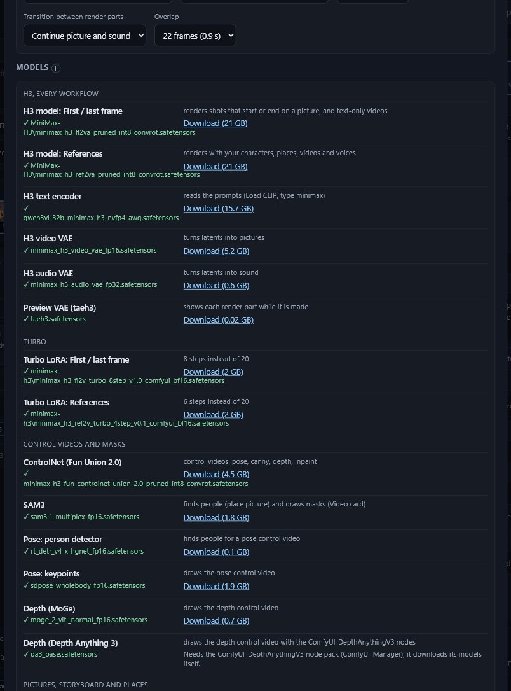

Every file H3 Director uses, grouped (H3, Turbo, Control, Pictures, Sound): found with its file name, or missing, and
always with its download link and size. Below it the files for place pictures (SAM3, Qwen Image 2.1) can be chosen when
yours are renamed. All links are also in chapter 2.

#### Manual prompt

Replaces the prompt of **every** render part. Leave it empty unless you write the whole H3 prompt yourself.

### Prompts per render part

| Field | What it does |
|---|---|
| Badge | where the part's prompt comes from: compiled, AI-written, edited, manual, or *own prompt outdated* |
| **Write with AI / Write all parts with AI** | the AI writes the part out in full; timing, names and spoken lines stay the planner's |
| **Edit / Save / Reset** | write the part yourself, store it, or go back to the compiled prompt |
| Notes | the planner's warnings for this part |

---

## Writing with the AI

An AI model can write for you: shots from a story, the prompt of each render part, descriptions of your pictures. It is
**optional** — every workflow runs without it, and nothing the AI suggests changes anything until you press **Accept**.

### The H3 AI Loader

Connect it to the Context Connector (for the Director and every card behind it). The Director shows **AI connected** when
it is ready.

| Source | What it uses |
|---|---|
| **Local** | a model on your machine through Ollama, LM Studio or llama.cpp |
| **API** | an online provider (OpenAI, Anthropic, Gemini, OpenRouter or a compatible one) |
| **CLIP / Encoder** | a generative text encoder loaded in ComfyUI, e.g. `qwen3vl_4b` (type `stable_diffusion`) |

**Quick start with Ollama:** install [Ollama](https://ollama.com), get a vision model (`ollama pull qwen3.5:9b` was tested
and sees pictures correctly), choose *Local → Ollama* and press **Load models**.

API keys are stored in ComfyUI's user settings, never in the workflow file.

H3's own text encoder (`qwen3vl_32b_minimax_h3_*`) cannot write; choose another model for the AI.

### What the AI can do

| Where | Button | Result |
|---|---|---|
| Director | **Make H3 prompt** | the whole video planned from your pictures and a direction: Look, timed shots, lines, sound |
| Director | **AI: split into shots** | your Prompt cut into shots with camera and spoken lines |
| A shot | **AI: suggest text** / **AI: improve text** | a new text for this shot |
| Prompts per render part | **Write with AI** / **Write all parts with AI** | the part's H3 prompt written out in full |
| A card | **✦ Analyze** | description, content and role of the picture, video or text |
| Storyboard | **AI: write panel texts** | titles, captions and shot texts of every panel |

Proposals for shots appear dashed on the timeline; **Accept** takes them, **Discard** leaves everything as it was.
**Cancel** in the status line stops a running request. Lines you wrote yourself always win over the AI's.

### Make H3 prompt

Choose a **direction** (*Let the AI decide*, *Music video*, *Song (singing)*, *Story*, *Action / fight*, *Calm scene*, *Dance*,
*Horror / suspense*, *Comedy*, *Romance* …) and whether anyone speaks (*No speech*, *Dialogue*, *Narrator*, *Singing*, with the language).
Pictures on the cards are enough; a Prompt is used when there is one. **Duration** sets the length. **Undo** in the
message puts everything back.

*Spicy 18+* is for adults only: anything that speaks of a minor is refused before any AI is asked.

### Tips

- A model that really sees pictures matters: some models say they can see and invent descriptions.
- Small models (4B) follow the format but write thin texts; 8–9B models are a good start.
- The AI never changes shot times or your spoken lines.

---

## Pictures and the picture editor

### Pictures output

**Output: Pictures** in the Director makes one picture per shot instead of a video (Workflow 5). The pictures are saved to
`output/H3/` and copied to `input/h3-director-stills`, so every Image card can choose them — for example as the first frame
of a video shot.

- A shot with only text is text-to-image.
- Cards on a shot are references: a character, an outfit, a place and a pose can be put together in one picture.
- A **First frame** picture on a shot is changed as the shot says and otherwise kept.

### The picture editor

The **pencil** on an Image card opens the editor in a window over the graph. It has three tabs; every result can be added
as a **new card** (connected to the Connector for you).

#### Mask

Paint with **Brush** and **Eraser** what may change, or write what to find (e.g. `mug`) and press **Find with SAM 3.1**.
**Save mask** stores it on the card: white changes, the rest stays. Used by the **Pictures** output: only the masked area
of a First frame picture is redrawn. Needs SAM3 for *Find* (chapter 2).

#### Structure

**Pose**, **Edges (Canny)** or **Depth** of this picture, as a new card. Put it on a shot of the Pictures output and the new
picture takes over the pose or layout; it is never drawn itself. Pose and Depth need their models (chapter 2).

#### Sheet

- **Make character sheet**: H3 circles the figure once and keeps six views — front, left, back, right, three-quarter and
  the face. About 4 minutes with the References turbo LoRA. **Use as this card's picture** or **Add as new card**.
- **Make place sheet**: H3 turns once inside the place and keeps six views all around. About 9 minutes.

A sheet helps H3 keep a figure the same from every side; put it on the figure's card, or add it as a card that **Belongs
to** the figure.

### Place like an earlier shot

In a shot's panel, **Place** can be set to *Like Shot 1* (any earlier shot). The Director then takes a picture of that
shot's place from its own render and gives it to the later shot as a place reference, so a room you come back to looks the
same.

| Picture | What it is |
|---|---|
| **Without people** (default) | the frame with the least person in it; if someone is still there, Qwen Image 2.1 paints them out |
| **As rendered (1 s in)** | the frame one second into the earlier shot |
| **From another view …** | Qwen paints the place from the camera you write, e.g. *from the bar toward the door* |

Such a shot starts a render part of its own (a cut), because the picture exists only once the earlier shot is rendered.
*Without people* and *From another view* need SAM3 and Qwen Image 2.1 (Settings → Models).

---

## Storyboard

**H3 Storyboard** lays out a storyboard sheet in the node: a title line with your characters, then 1–9 numbered panels,
each with its time, title, caption and the shot text for H3. Workflow 6 walks through an example; this chapter lists
everything the node can do.

### Wiring

One cable: the Context Connector's **H3 context** output (the one that goes to the Director) into the Storyboard's
**H3 context** input. Through it the Storyboard sees your picture cards, the AI and the Director. It hands the Director
nothing by cable; its buttons write into the Director. Its outputs are optional: **sheet** (the sheet as drawn),
**panels** (each panel's picture) and **shots** (the panels as the Director's shots). Left unconnected, the node does not
run with the workflow.

### The board

| Field | What it does |
|---|---|
| **Panels** | 1–9 panels in a grid |
| **Panel format** | 16:9, 9:16, 1:1, 4:3, 3:4, 21:9 — the shape of the video |
| **Gear** | the models the storyboard uses, found or missing, with downloads |
| **Undo / Redo** | every change on the board |
| **Title / Subtitle** | the sheet's title line; your character cards appear under it |
| **What should happen** | the story in a few sentences, for the AI |
| **AI: write panel texts** | the AI writes the sheet's title and every panel's title, caption and shot text; times stay |
| **Redraw all panels** | every panel's collage redrawn with Qwen Image 2.1 |

### A panel

| Field | What it does |
|---|---|
| **Seconds** | the panel's length; panels follow each other (5 s, 5 s … are 0–5, 5–10 …) |
| **Title** | the title on the sheet |
| **+ Picture** | a picture from your cards, from this storyboard, the input folder (search) or **Upload…** |
| **+ Text / + Colour** | a text layer or a colour area |
| **+ Figure from a sheet** | Qwen Image 2.1 draws a character card's figure in the pose you write, without background (about 30 s) |
| **+ Background** | Qwen Image 2.1 draws an empty place in the panel's format (about 20 s) |
| **Redraw with Qwen Image 2.1** | the panel's collage painted as one finished picture, a new layer on top (about a minute) |
| **First frame / Last frame of its shot** | *Send to Director* uses the panel's picture as that frame of its shot |
| **Caption on the sheet** | the line under the panel |
| **Shot text for H3** | what H3 renders: framing, action, camera; time beats for a long panel |

### Layers

| Action | How |
|---|---|
| Select | click it on the panel or in the list |
| Move | drag it on the panel |
| Size / turn | mouse wheel / **Shift** + mouse wheel, or the **Size** and **Rotation** sliders |
| **Opacity**, **Mirror**, **Centre** | in the layer's controls |
| **Cut out** | removes a picture's background (ComfyUI's Remove Background with BiRefNet); Undo brings it back |
| **Use on all panels** | copies the layer to every other panel at the same place |
| In front / behind | the arrows in the list |
| **Hide / Show**, remove | in the list |

Pictures dragged from a folder or from ComfyUI's queue land on the panel they are dropped on; several stand side by side.

### Into the Director

| Button | What it does |
|---|---|
| **Use in Director** | draws the sheet into `input/h3-storyboard` and adds a Context card with it (*Use as: Storyboard*) at the Connector |
| **Send to Director** | panels become shots (times and shot texts), the sheet goes on every shot, marked panels become first or last frames; sound lanes, Look and Prompt stay |
| **Sync from Director** | lengths and texts changed in the Director go back into the panels |

### Saving and reloading

The board is saved with the workflow. The drawn sheet is a PNG that carries the whole storyboard: drag it onto any H3
Storyboard and every panel, layer and text comes back (Undo goes back). Pictures you made are saved in
`input/h3-storyboard`.

### Models

| Feature | Needs (chapter 2) |
|---|---|
| + Figure from a sheet, + Background, Redraw | Qwen Image 2.1, its text encoder and VAE |
| Cut out | BiRefNet (`birefnet.safetensors`) |
| AI: write panel texts | an H3 AI Loader on the Connector |

Without them the storyboard still works with your own pictures and texts.

### Tips

- A storyboard plans shots in **References** mode.
- Characters look like themselves when they come from their sheets: use **+ Figure from a sheet** or cut-outs of the
  sheet, then **Redraw** the panel so light and style fit together.
- Write the side each character stands on into the shot text; H3 follows the text more than the picture.
- Four to six panels for 10–30 seconds.

---

## Control video (experimental)

A control video steers each frame of the picture through the official H3 ControlNet (Fun ControlNet-Union 2.0). Workflow 7
shows pose, edges and depth; Workflow 8 shows inpainting with a mask.

### What you need

- A **ModelPatchLoader** with `minimax_h3_fun_controlnet_union_2.0_pruned_int8_convrot.safetensors` on the Context
  Connector's **model_patch** input. Without it the Studio says so.
- A **Video** card with **Use as: Control video**.

### The kinds

| Kind | Made from | Keeps | Needs |
|---|---|---|---|
| **Pose** | a person in a video | body and hand positions, the path | RT-DETR + SDPose |
| **Canny** | any video | outlines and layout; also the outlines of clothes and hair | nothing extra |
| **Depth** | any video | space and layout | MoGe (or the Depth Anything 3 nodes) |
| **Inpaint** | footage + mask | everything outside the mask; the mask area is redrawn | SAM3 for the mask |

**Generate Pose / Canny / Depth** on the card runs once through ComfyUI's queue and saves the result in
`input/h3-control`. Rendering reads the saved file; it does not run the conversion again. A ready control video can be chosen
directly.

### On the timeline

Drag the card onto the **Control** lane. Move and trim clips with the mouse; select a clip to set its offset in the file.
Several clips of different kinds can follow each other; they may not overlap. Control works in both modes and uses no
reference slot.

### Strength

**Settings → ControlNet → Strength**: 1 follows the control video closely; 0.5 keeps more of your figure's own shape.
Measured: Canny at 1.0 took over the source's cloak; at 0.5 the figure kept her own outfit and hair. Depth at 1.0 carried
the other figure's hair over, 0.5 did not.

### Render-part edges

H3 applies the ControlNet to a whole render part. If a clip starts or ends inside a part, its first or last frame is held
to the part's edge, and that held frame steers there too. The Studio warns and names the parts. Let clips cover whole
parts, or choose shorter render parts. A part without any clip renders without ControlNet.

### Tips

- Generated control videos keep the source's frame rate; the Director resamples them to H3's 24 fps.
- Sources longer than 4096 frames: split them into shorter clips first.
- After changing a mask's footage, generate or choose its mask again.

---

## Tips and problems

### Writing shots

- **Framing, action, camera** — in this order, one camera sentence per shot. Without it H3 chooses its own camera and
  may cut away or zoom in.
- Say **in which direction** someone moves: *climbs up the stairs, facing the steps ahead of him*. "Climbs the stairs"
  alone came out as walking backwards.
- Describe **only what is seen**. "Remembering her lost master" can make H3 show that master.
- A new action needs about **two seconds** after a shot starts; shots under 3 s often show only the beginning.
- A change of view is a **new shot**. A long shot can be written in time beats: `0–4s: … 4–8s: …`.
- If a take is not right, try another **seed** (Settings → Sampling) before rewriting.

### Problems and what helps

| You see | What helps |
|---|---|
| A model loader is red, *file not found* | download the file (chapter 2) or choose your own file in the loader |
| *Turbo needs a turbo LoRA* | choose the LoRA in **Settings → Turbo**, or switch Turbo off |
| Out of memory | **Render part: 5 s**, the int8 video VAE, or **Resolution: Fast** |
| A white veil over the video (References turbo) | 6 steps instead of 4 — the known LoRA sets it by itself |
| The same figure appears twice | a second picture of a figure needs **Belongs to** that figure |
| A figure looks different later in a long video | use **References** mode; give the figure a character sheet (picture editor) |
| A spoken line is missing or cut off | give the shot more time, or split the line |
| The voice sounds wrong | use a clean voice sample, 3–10 s, no music |
| A song gets dull or the lips are off | **Use as: Lock** for the song; time the lyrics with Whisper |
| A visible jump at a join | **Transition: Continue picture and sound**; the planner places joins away from new actions |
| A room looks different when you come back | **Place: Like Shot N** in the later shot (chapter *Pictures*) |
| *needs a connected Video card with Use as: Control video* | connect the card to the Connector and set it to *Control video* |
| *has no video yet* | choose or upload a video on that card |
| ComfyUI crashed during a render | queue the same project again: finished parts are loaded (**Resume**) |
| The AI buttons are grey | connect an **H3 AI Loader** (chapter *Writing with the AI*) |
| The AI describes things that are not in the picture | the model cannot really see pictures; try `qwen3.5:9b` |

### Times (16 GB card, 1280×704, Turbo on)

| Job | About |
|---|---|
| 15 s text to video | 15–20 minutes |
| One picture (Pictures output) | 30–45 seconds |
| Character sheet | 4 minutes |

Longer videos take longer in proportion; try 15–30 s first, then make the whole length.

### Where things are saved

| What | Folder |
|---|---|
| Finished videos and pictures | `output/H3/` |
| Pictures for later use | `input/h3-director-stills` |
| Control videos and masks | `input/h3-control` |
| Storyboard pictures | `input/h3-storyboard` |
| Finished render parts (Resume) | `output/h3-director-resume` |
| Card presets | `user/default/minimax_h3_ng/contexts` |

### The guide node

The **H3 Guide** does nothing when the workflow runs. Delete it when you no longer need it, or add it to any workflow
(*MiniMax H3 → NG → H3 Guide*) and choose a chapter.

### Help from an AI agent

An AI agent (Claude, ChatGPT, …) with access to your computer can install the pack, check your models and find what went
wrong: point it at `SKILL.md` in the node pack's folder. It lists the installation, the models, the example workflows and
the usual problems with their fixes.
