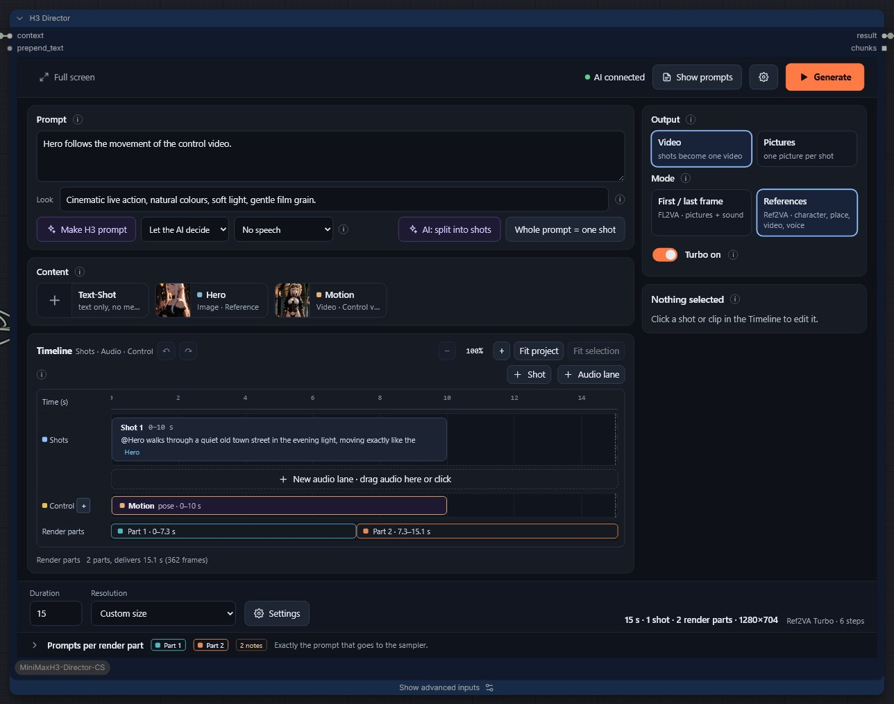

# Control video (experimental)

A control video steers each frame of the picture through the official H3 ControlNet (Fun ControlNet-Union 2.0). Workflow 7
shows pose, edges and depth; Workflow 8 shows inpainting with a mask.

## What you need

- A **ModelPatchLoader** with `minimax_h3_fun_controlnet_union_2.0_pruned_int8_convrot.safetensors` on the Context
  Connector's **model_patch** input. Without it the Studio says so.
- A **Video** card with **Use as: Control video**.

## The kinds

| Kind | Made from | Keeps | Needs |
|---|---|---|---|
| **Pose** | a person in a video | body and hand positions, the path | RT-DETR + SDPose |
| **Canny** | any video | outlines and layout; also the outlines of clothes and hair | nothing extra |
| **Depth** | any video | space and layout | MoGe (or the Depth Anything 3 nodes) |
| **Inpaint** | footage + mask | everything outside the mask; the mask area is redrawn | SAM3 for the mask |

**Generate Pose / Canny / Depth** on the card runs once through ComfyUI's queue and saves the result in
`input/h3-control`. Rendering reads the saved file; it does not run the conversion again. A ready control video can be chosen
directly.

## On the timeline

Drag the card onto the **Control** lane. Move and trim clips with the mouse; select a clip to set its offset in the file.
Several clips of different kinds can follow each other; they may not overlap. Control works in both modes and uses no
reference slot.

## Strength

**Settings → ControlNet → Strength**: 1 follows the control video closely; 0.5 keeps more of your figure's own shape.
Measured: Canny at 1.0 took over the source's cloak; at 0.5 the figure kept her own outfit and hair. Depth at 1.0 carried
the other figure's hair over, 0.5 did not.

## Render-part edges

H3 applies the ControlNet to a whole render part. If a clip starts or ends inside a part, its first or last frame is held
to the part's edge, and that held frame steers there too. The Studio warns and names the parts. Let clips cover whole
parts, or choose shorter render parts. A part without any clip renders without ControlNet.

## Tips

- Generated control videos keep the source's frame rate; the Director resamples them to H3's 24 fps.
- Sources longer than 4096 frames: split them into shorter clips first.
- After changing a mask's footage, generate or choose its mask again.
