# Workflow 2 · Characters and voice

A figure from your own picture walks through a town and speaks one line with a voice from your own sound file. This workflow
shows every node the H3 Director uses for that, from left to right.

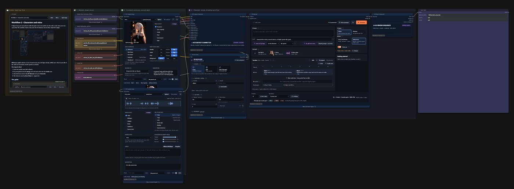

**What you need:** a picture of your character (any size, the figure clearly visible) and a short sound file of the voice
(3–10 seconds of clear speech, no music).

**The steps in short**

1. Load the models once (left column).
2. Put your picture into the **Image** card and your voice into the **Audio** card.
3. Check the two shots in the **H3 Director** and press **Generate**.
4. The video is saved by **Save Video** in `output/H3/`.

## The guide

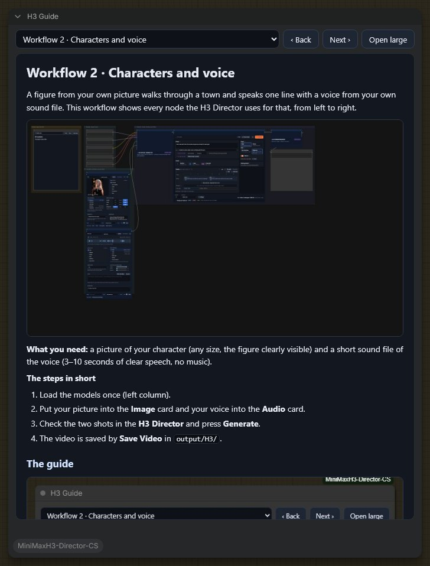

This node is the guide you are reading. It does nothing when the workflow runs. Choose a chapter in the list, step with
**Back** and **Next**, or open it in a large window with **Open large**. Click a picture to see it full size.

## 1 · Models

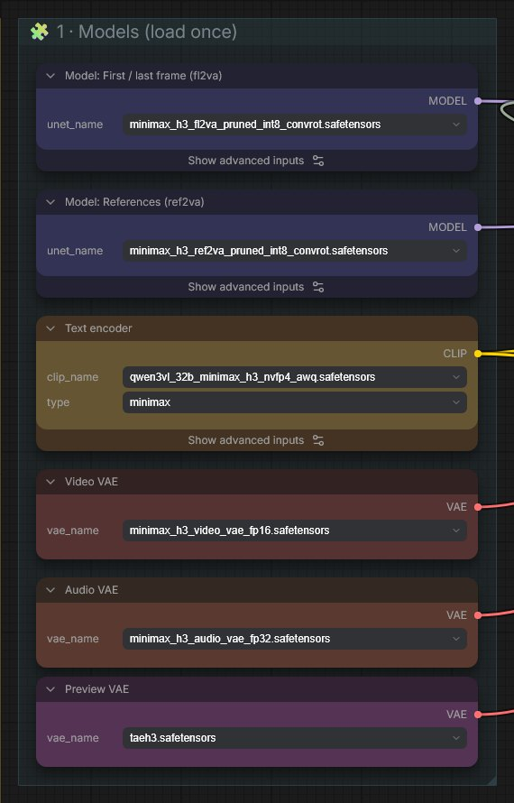

Six ComfyUI loaders, each loads one file. They are the same in every workflow; the colours tell them apart (blue: the two
H3 models, yellow: the text encoder, red: the VAEs, purple: the preview VAE).

| Node | File | Folder |
|---|---|---|
| Model: First / last frame | `minimax_h3_fl2va_pruned_int8_convrot.safetensors` | `models/diffusion_models` |
| Model: References | `minimax_h3_ref2va_pruned_int8_convrot.safetensors` | `models/diffusion_models` |
| Text encoder | `qwen3vl_32b_minimax_h3_nvfp4_awq.safetensors` (type `minimax`) | `models/text_encoders` |
| Video VAE | `minimax_h3_video_vae_fp16.safetensors` | `models/vae` |
| Audio VAE | `minimax_h3_audio_vae_fp32.safetensors` | `models/vae` |
| Preview VAE | `taeh3.safetensors` (small, for the live preview) | `models/vae_approx` |

If a file is missing, ComfyUI offers to download it: the workflow carries the links. Your files can have other names or
lie in a subfolder; then pick them in the loader. Only the model a render part needs is loaded: a project in References
mode never loads the First / last frame model.

> Little VRAM? Use 5 s render parts (Settings) and the int8 video VAE `minimax_h3_video_vae_int8_convrot.safetensors`.

## 2 · Content: the Image card

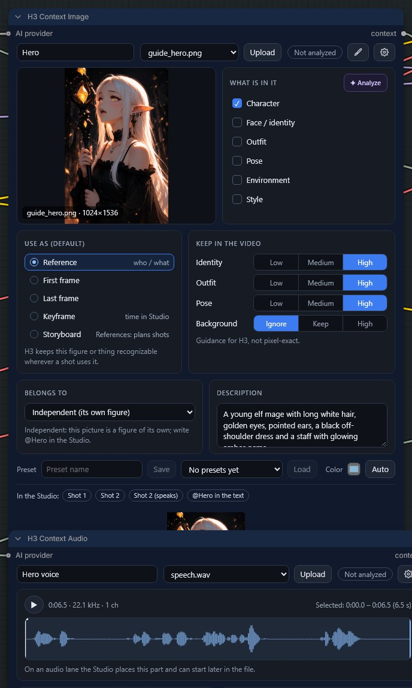

The **H3 Context Image** card holds one picture and says what it is for.

- **Name** (top left): how you call the figure in the Studio. With the name *Hero* you write `@Hero` in a shot.
- **Picture**: choose a file from the list or press **Upload**. The pencil opens the picture editor (masks, poses, a
  character sheet), the gear the card's settings.
- **What is in it**: what the picture shows. Here *Character*.
- **Use as**: *Reference* keeps this figure recognizable wherever a shot uses it. *First frame* / *Last frame* make the
  picture the first or last frame of a shot instead (chapter *References or first frames*).
- **Keep in the video**: how strictly H3 keeps identity, outfit and pose of the picture. *Background: Ignore* lets the
  shot put the figure into its own place.
- **Belongs to**: leave *Independent* for a figure of its own. A second picture of the same figure (a side view, the back)
  belongs to the first one, otherwise H3 treats them as two people and switches between them.
- **Description**: one sentence of what the picture shows. H3 reads it together with the picture.
- **In the Studio** (bottom): where the card is used, here in shot 1, shot 2 and as the speaker in shot 2.

## 2 · Content: the Audio card

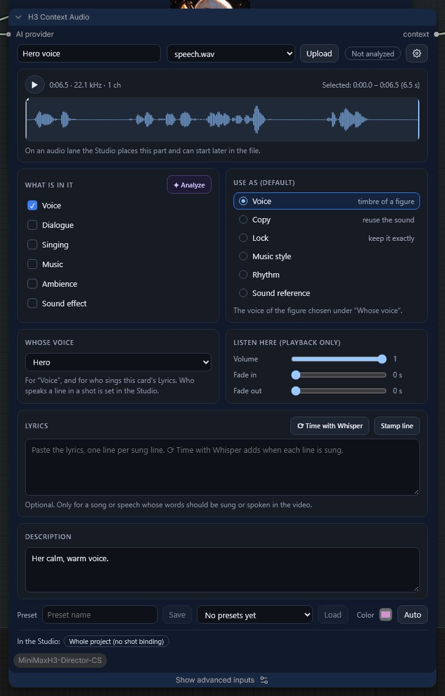

The **H3 Context Audio** card holds one sound file. Play it with ▶; the marked range is the part that is used.

- **What is in it**: *Voice*.
- **Use as**: *Voice* gives the figure the sound of this voice. (*Lock* keeps a song exactly as it is, see Workflow 3.)
- **Whose voice**: the figure that speaks with it, here *Hero*.
- **Listen here**: volume and fades only for listening in the browser; they do not change the video.
- **Lyrics**: only for a song or a speech whose words must be said exactly.

## 3 · H3 Context Connector

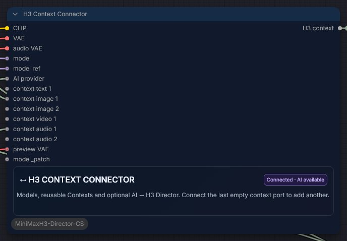

The Connector collects everything the Director needs: the models, the text encoder, the VAEs and the content cards.
Connect a new card to the last empty *context* input; a new empty input appears. The **preview VAE** shows every render
part while it is being made; without it the render works the same, only without the live picture.

## 3 · H3 AI Loader (optional)

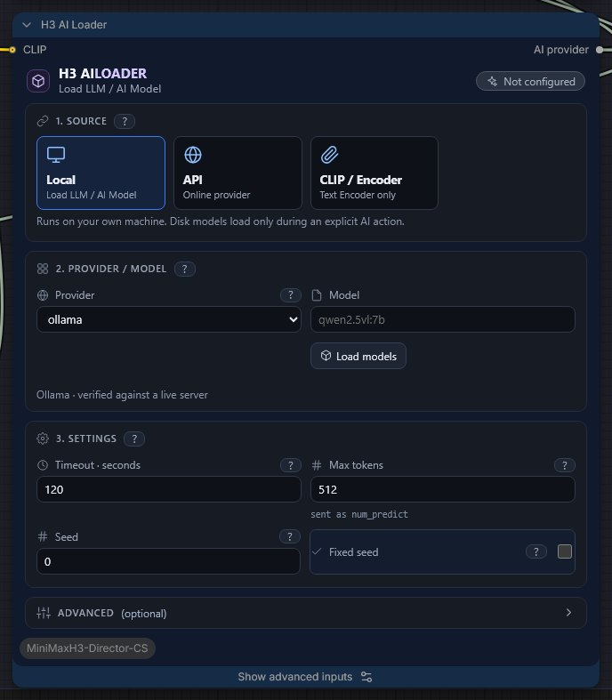

The AI Loader lets an AI write for you: shot texts, the prompts of the render parts, descriptions of your pictures
(**Analyze** on a card). Nothing needs it — every workflow runs without AI.

- **Source**: *Local* (a model on your own machine, for example with Ollama), *API* (an online provider) or *CLIP /
  Encoder* (only reads, does not write).
- **Provider / Model**: for Ollama choose the model with **Load models**, e.g. a Qwen vision model.
- It is connected to the Connector and to every card; the Director shows **AI connected** at the top when it is ready.

## 3 · H3 Director: the Studio

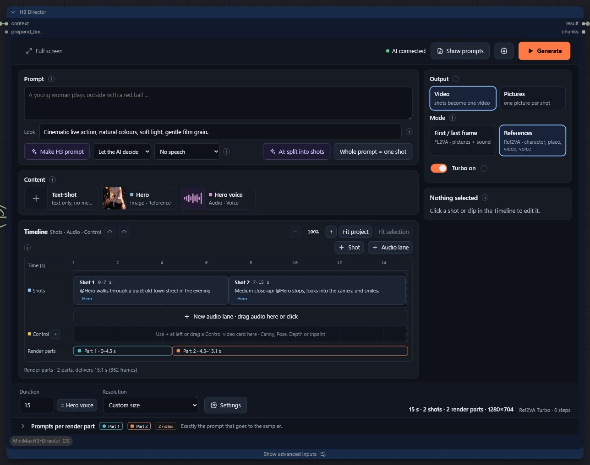

The Director is where you plan the video. Everything happens inside the node.

- **Prompt**: what the whole video is about, in one or two sentences.
- **Look**: the style that every render part shares.
- **Output**: *Video*, or *Pictures* (one picture per shot, Workflow 5).
- **Mode**: *References* (Ref2VA) uses your character pictures and voices. *First / last frame* (FL2VA) starts shots on
  pictures. With the Image card set to *Reference* the Director chooses References by itself.
- **Turbo on**: renders with a few-step turbo LoRA: about three times faster. The LoRA is set in Settings.
- **Content**: the cards from the Connector. Drag a card onto a shot to use it there.
- **Timeline**: the shots, audio lanes and control clips over time. **Render parts** below shows how the Director cuts the
  video into parts of up to about 10 s that continue into each other.
- **Duration** and **Resolution** at the bottom; **Generate** at the top right starts the render.

### A shot

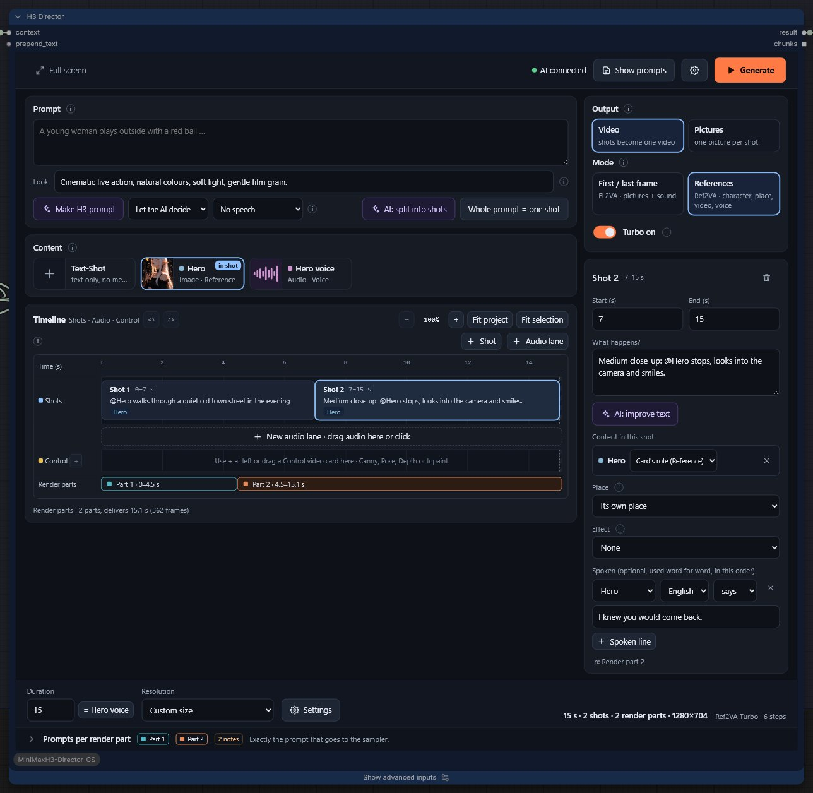

Click a shot to edit it on the right:

- **Start / End** in seconds.
- **What happens?**: the action of the shot. `@Hero` names the figure from the Image card. Write how the camera moves,
  for example *The camera tracks beside her.*
- **Content in this shot**: the cards used in this shot.
- **Spoken**: a line that is said word for word, with the speaker, language and way of speaking.
- **Effect**: an official H3 camera effect such as *Bullet time* (only shown when the effect files are installed).

### Settings (gear)

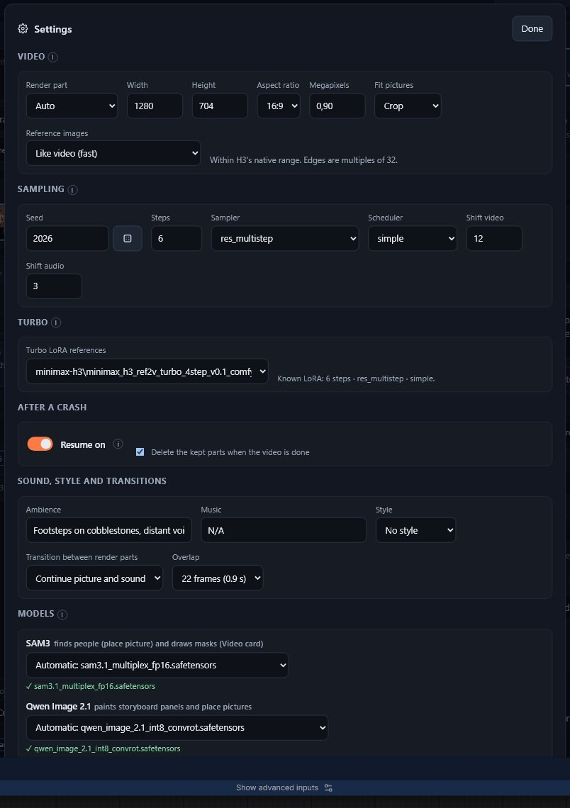

**Settings** holds everything a first video does not need: render part length, size, seed, steps, sampler, the turbo LoRA,
resume after a crash, sound and transitions, and the extra models. A known turbo LoRA brings its own steps and sampler
(here 6 steps for the References LoRA).

### Prompts per render part

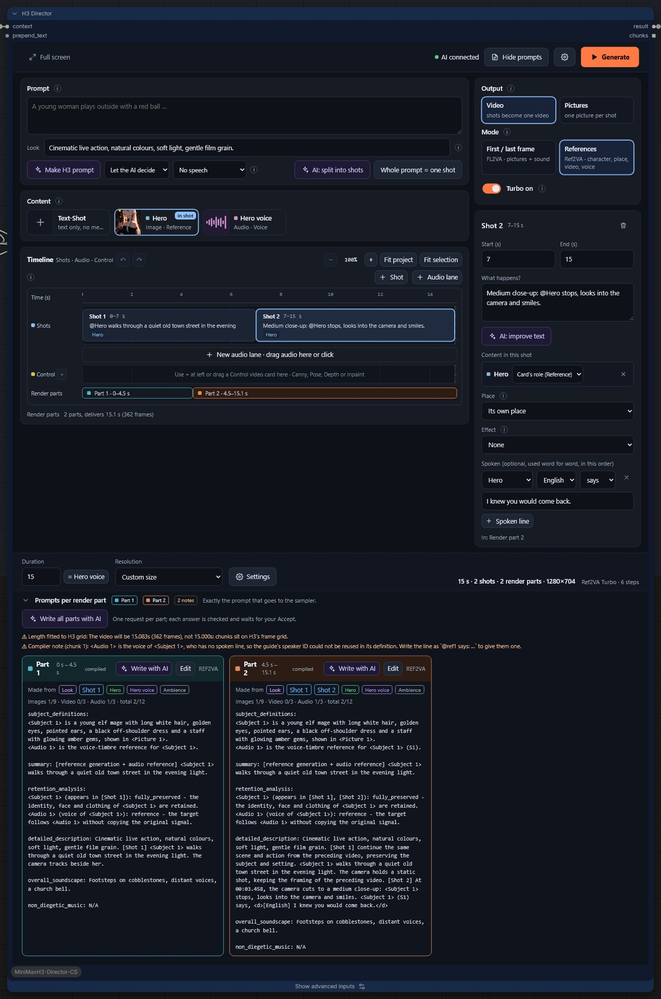

**Prompts per render part** (bottom of the Director) shows exactly the prompt that goes to H3 for every part, with the
notes of the planner above it. You can let the AI rewrite a part or edit it yourself.

## 4 · H3 Render Sequence

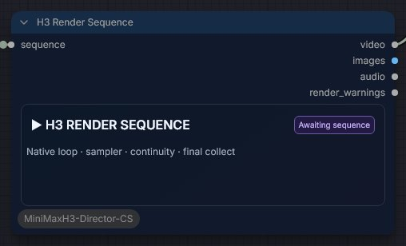

Renders the parts one after another, carries picture and sound across each seam, and puts them together into one video.
Outputs: *video*, *images* (in Pictures mode), *audio* and *render_warnings*. After a crash, finished parts are kept and
only the missing ones are rendered again.

## 5 · Save Video

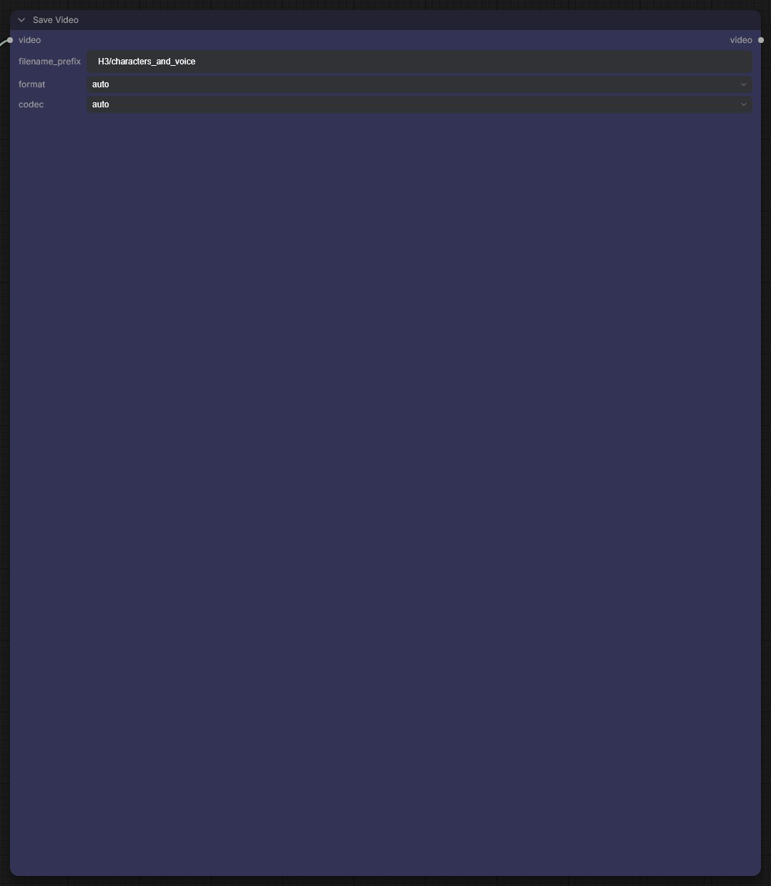

ComfyUI's own Save Video. The file lands in `ComfyUI/output/H3/characters_and_voice_00001_.mp4`.

## Tips for this workflow

- Describe the camera in every shot. Without it H3 chooses its own camera and may cut away.
- One picture per figure, or set **Belongs to** for more pictures of the same figure.
- The voice sample should be clean speech. Music or noise in it changes the voice.
